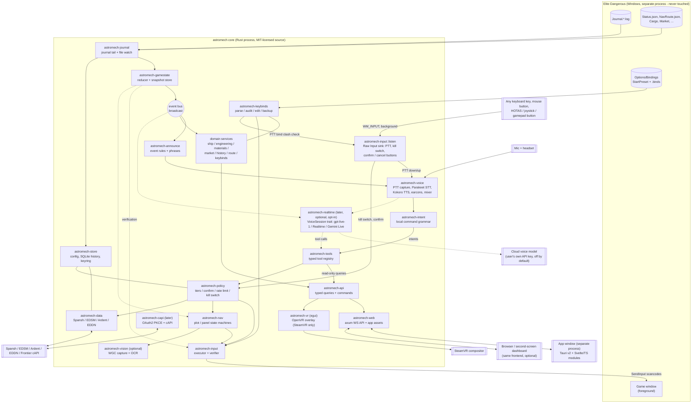
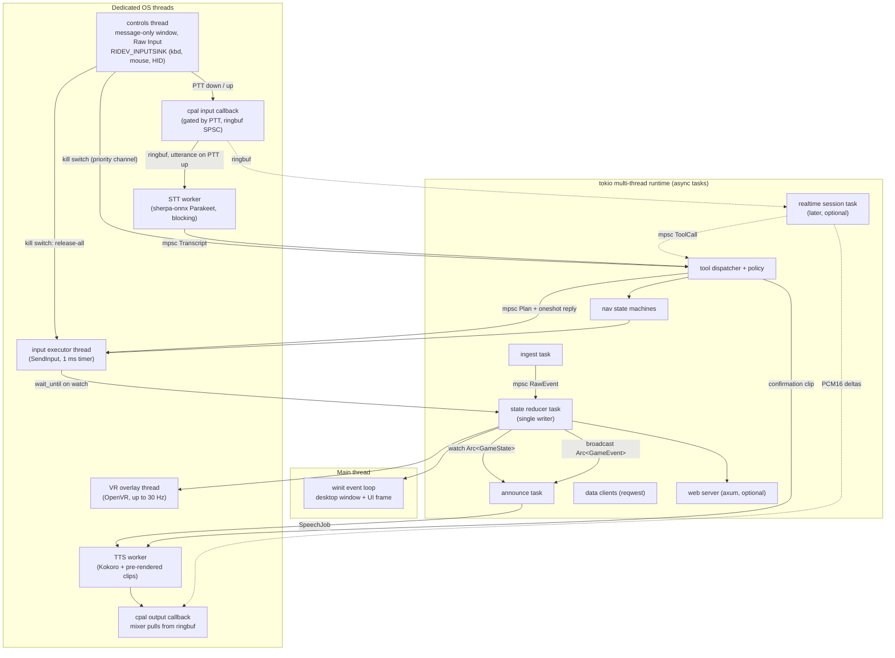
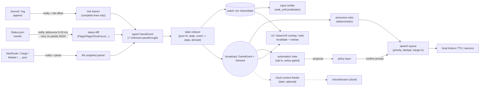
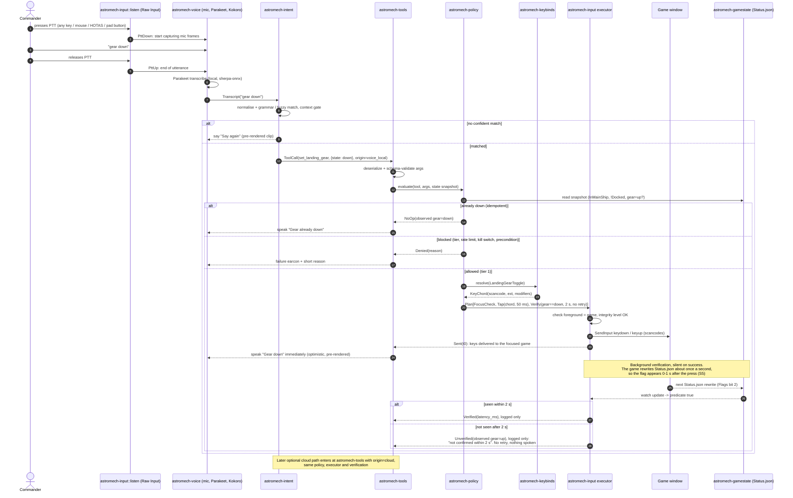
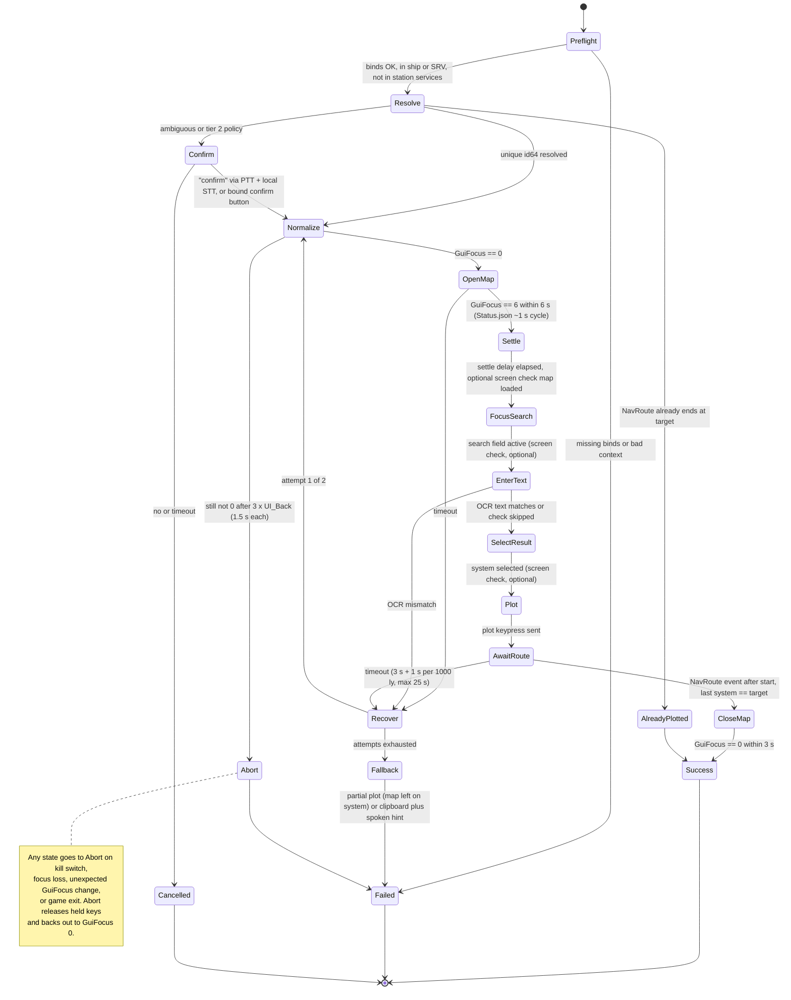

# astromech, an Elite Dangerous copilot: architecture (v0.16 draft)

*Revised 11 Oct 2026 (America/New_York). Builds on [REPORT.md](REPORT.md). Spike results are in §17.*

**Project name.** **astromech** (v0.10; it replaces the earlier `helm` placeholder). Crates are `astromech-*`. Repo: https://github.com/spadaval/astromech.

**Diagrams.** Mermaid sources and rendered PNGs are in [`diagrams/`](diagrams/).

**Crate versions.** Checked against crates.io on 8 Oct 2026. (The raw lookup stayed in the research notes and is not in this repo.)

**Marking convention.**
- **⚠ UNVERIFIED**: I couldn't confirm it. Settle it with a spike or test before relying on it.
- **Decision**: an opinionated call. It can be revisited if a spike says otherwise.

**Revision history**
- **v0.14 (11 Oct):** **Voice colour.** Spoken replies stay on Kokoro; a cockpit-PA DSP chain (the §5.10 "radio DSP") is the v1 default so they sit in the same register as Elite's COVAS. Product decision in V1-DESIGN.md §6.4. Mixer + Cockpit DSP shipped in the M3 output-path slice; remaining M3 (chosen mic, gain, T1 extras, status questions, aliases, eval) in V1-DESIGN.md §7.13.
- **v0.16 (11 Oct):** **HGE sources.** Manufactured G4–G5 notes name High Grade Emissions by faction allegiance and state (not economy). `FSDJump`/`Location` carry factions; the Materials pane shows a likely pool for the current system.
- **v0.15 (11 Oct):** **Materials.** `astromech-materials` folds a login `Materials` snapshot plus later journal deltas into a trader-style grid (raw / manufactured / encoded) in the app window.
- **v0.1 (8 Oct, morning):** first draft.
- **v0.2 (8 Oct, evening):** applies Sumeet's answers.
  - MVP voice is local only, with push-to-talk and no wake word. Cloud realtime voice becomes a later, opt-in phase.
  - Push-to-talk, kill switch and confirm/cancel can be bound to any input device (new crate `astromech-input::listen`).
  - The project is open source (new §16). Code signing is nice-to-have, not a must.
  - VR is SteamVR only.
  - The integrity-level (UIPI) check warns in both directions.
- **v0.3 (8 Oct, 6:40 PM ET):** Sumeet chose the **MIT** licence (single licence, no copyleft split), recorded in §16.1. The licence open question is removed.
- **v0.4 (8 Oct, 11:30 PM ET):** results of spikes **S5, S6 and S8** (new §17).
  - **S5** (real game): every keypress landed, but the game rewrites Status.json only about once a second, so verification takes 0–1 s. Confirmations are now spoken **optimistically** on `SendInput`, with silent background verification (2 s timeout, one retry) that speaks only on failure. Polling is dropped; file notifications only. Default tap hold 50 ms (range 40–60). Plotting timeouts lengthened. MVP latency targets revised (§11, §14).
  - **S6:** don't use `ed-journals` at runtime; write our own open-enum models for the ~35 events we act on, keep every line as raw JSON, and test against its MIT corpus (§5.2, §17.2).
  - **S8:** espeak-ng (GPL-3.0) **is** inside the prebuilt sherpa-onnx 1.x libraries, so release binaries are GPL-3.0 as a whole until sherpa-onnx 2.0. The prebuilt Windows libraries are MSVC-only. Revised `cargo-deny` allowlist; model licences confirmed (§16, §17.3).
  - The unmeasured voice-speed parts of the old S5 move to a new spike **S9**.
- **v0.5 (9 Oct, 1:30 PM ET):** S9 tool fixes and the GPU/inference-stack decision (§17.5). Sumeet's GPU is an **AMD Radeon RX 9070 XT (RDNA4)**.
  - **CUDA is dropped** from the tool and the plan.
  - The voice worker now **links sherpa-onnx + onnxruntime statically** (static-MT prebuilt). It needs no DLLs, which fixes the "sherpa-onnx-c-api.dll missing" failure.
  - **MVP voice runs on the CPU** with sherpa-onnx. GPU is optional and goes through **DirectML via the `ort` crate** (works on AMD/Intel/NVIDIA with no installs). S9 measures it on Sumeet's PC with a raw-graph probe.
  - **burn can't import** today's Parakeet int8 or Kokoro ONNX files.
  - **Long-term stack:** stay on sherpa-onnx for the MVP. Move to `ort` directly only if the GPU numbers or the espeak-ng (GPL) question justify reimplementing features, TDT decoding and G2P (§5.10, §17.5).
- **v0.6 (10 Oct, 1:30 PM ET):** keybind management ("Keybinds Studio") is researched and planned in **KEYBINDS.md**. Architecture outcome (§18):
  - Decision 1 is amended. The core stays all-Rust, and egui stays for the in-game panel and the VR overlay.
  - The complex out-of-game UI is **one Svelte + TypeScript frontend**, served by `astromech-web`. It's shown in a thin **Tauri v2 shell (`astromech-shell.exe`), a separate process** launched from the tray, with the system browser as a fallback.
  - The optional dashboard reuses that frontend; this replaces the egui-to-wasm plan.
  - Profile writes happen only while the game is closed.
  - New spikes: **K0** (game binds behaviour) and **S11** (WebView2 cost with Elite running).
- **v0.7 (10 Oct, 2:45 PM ET):** Sumeet wants **one comprehensive app, not a suite**; fragmentation is the problem being solved.
  - "Keybinds Studio" becomes the **app window** (placeholder name; binary `astromech-shell.exe`). It's a Svelte 5 + TS **app shell** hosting **modules**: keybinds first, then ship/loadout, engineering and materials, logbook, route, trading, exploration.
  - New **module architecture (§18):** domain services in the core, behind one typed query/command API (`astromech-api`, `astromech-proto`). It's shared by UI modules, the egui VR overlay, the web dashboard and the voice tool registry.
  - New sections on **game-data sources and licensing** (Frontier IP, FDevIDs, coriolis-data) and **SQLite journal history** (rusqlite).
  - **Process model re-checked: still two processes.** The core is always on while playing; the app window opens on launch, and closing it frees WebView2.
  - The egui **desktop** window is retired: egui = VR overlay only.
  - New **module roadmap (§18.7)**, mapping each module to the copilot tools it unlocks.
  - EDRefCard is parked. Middleman input apps are out of scope.
  - Diagrams: 01 updated; new 08 (app processes, replacing 06) and 09 (modules/domain).
- **v0.10 (10 Oct, 5:45 PM ET):** Codename **astromech** replaces `helm`; all crate names are now `astromech-*`. The repo is scaffolded (§4). Name changes from earlier drafts: `helm-binds`→`astromech-keybinds`, `helm-state`→`astromech-gamestate`, `helm-ingest`→`astromech-journal` + `astromech-status`, `helm-types`→`astromech-proto`, `helm-controls`→`astromech-input::listen`, `helm-ui`/`helm-vr`→`astromech-overlay`, `apps/helm`→`astromech-core`, and the app window→`astromech-shell`.
- **v0.13 (10 Oct, night):** second real-game round of the gear-down preview. Changes: PTT debounce, a clip gate (minimum hold and level), noise-only transcripts ignored, mic stream errors handled, game-vocabulary normalisation, a mishearing cap ("You're down" asks), and known-but-unavailable intents (supercruise, hyperspace jump, request docking, plot route). Hotwords were checked: supported but not enabled (§5.12). Details in §17.8.
- **v0.12 (10 Oct, night):** design change from Sumeet: **no verification retry and no spoken failure.** After a press, the Status.json watch still runs for up to `verify_timeout_ms` (2 s), but the outcome is only logged ("confirmed in N ms" / "not confirmed within 2 s"). Nothing is pressed twice and nothing is spoken. Silent state tracking still powers "already down" and the state rules. `[actions] retries` is deprecated and ignored. A future opt-in "tell me when a command didn't take" is noted in §5.5. Also the PTT idle-stick fix (§17.8).
- **v0.11 (10 Oct, evening):** the first vertical slice, "gear down" end to end (branch `slice/gear-down`). New crate `astromech-intent` (the §5.12 matcher, implemented); `astromech-core` now runs the journal/Status pipeline, the binds health check and the PTT voice path. Implementation notes and divergences are in §17.8; §4 and §5.12 updated to match.
- **v0.9 (10 Oct, 5:05 PM ET):** **S7 done** on Sumeet's PC with `s7-input-listener` (§17.7). With Elite focused, a Raw Input `RIDEV_INPUTSINK` listener got joystick, keyboard and mouse input. Elite does not take exclusive input from it. Mouse side buttons (4/5) were not tested.
- **v0.8 (10 Oct, 4:10 PM ET):** **S9 done** on Sumeet's PC (§17.6).
  - Release to transcript: median 85 ms. Kokoro first audio: median 446 ms. 4 inference threads by default.
  - Sumeet's verdict: good enough.
  - Fuzzy matching of transcripts to the grammar, with "did you mean…?", becomes an MVP must-have (§5.12). Hotword biasing is a to-check item; second-pass reprocessing is optional later; mic gain/AGC is noted.
  - S7 stays open. DirectML/S10 is still not measured.

---

## 1. Decisions already made (inputs)

1. **All-Rust core; one app window; egui for VR.** (v0.6/v0.7: amended from "no Tauri", §18.) The core process holds the domain services, voice, input and the SteamVR overlay (egui). The **one comprehensive app window** is a separate Tauri v2 + Svelte/TS process. They share **one wgpu device and renderer**. The UI library (egui, Slint or iced) will be chosen by a spike (§14).
2. **Optional second-screen web dashboard.** The core serves it over a local WebSocket. **The dashboard is never required.** (v0.7: it shows modules of the same Svelte/TS frontend as the app window, §18.)
3. **The MVP's voice is local only.**
   - Speech-to-text: sherpa-onnx with **Parakeet**.
   - Speech output: **Kokoro**, coloured as a cockpit PA by default (v0.14, V1-DESIGN.md §6.4).
   - Activation: **simple push-to-talk**. There is no wake word or always-on listening in the MVP.
   - Cloud full-duplex voice (`gpt-live-1` or an alternative) is kept as a `VoiceSession` trait for a **later, optional, opt-in phase**. It is never the default, and the user supplies their own API key.
4. **Controller-agnostic controls.** Push-to-talk, the kill switch and confirm/cancel can be bound to **any keyboard key, mouse button, or HOTAS, joystick or gamepad button**. No specific device is targeted.
5. **The model can never press arbitrary keys.** This applies to the local grammar and to any later cloud model. Each tool maps to an enumerated game action, and the action maps to a binding.
6. **Every keypress is verified** against Status.json or the journal.
7. **Event-triggered automation is opt-in and human-in-the-loop**, because of the Frontier EULA (see REPORT §5).
8. **Open source under the MIT licence** (Sumeet's decision, 8 Oct; §16).
9. **VR is SteamVR (OpenVR) only.** The Oculus-native runtime isn't supported.
10. **The game is assumed not to run elevated.** A startup integrity-level check warns clearly about any mismatch (§2, C3).

---

## 2. Goals, non-goals and constraints

### Goals
- **G1. A voice-first copilot.** Push-to-talk voice commands that do things in and around the game: toggles, screens, targeting, routes, plotting and keybinding chores. It also knows the live game state and announces relevant events.
- **G2. Trustworthy actions.** Each action has preconditions, verifies its own result, and reports honestly ("gear did not deploy: the game didn't respond within 1.5 s").
- **G3. Low latency on simple commands.** The key press starts ≤ 400 ms (p95) after push-to-talk is released, the spoken confirmation starts with it, and the result is verified (or a failure is spoken) within 2 s. Status.json is only rewritten about once a second (S5), so verification itself can't be faster than 0–1 s.
- **G4. Works in VR through SteamVR.** Audio first, plus a native OpenVR overlay. Push-to-talk is on a HOTAS or pad button, so no keyboard is needed.
- **G5. One small native binary.** Low CPU and GPU use alongside the game and a VR compositor.
- **G6. Fully offline-capable core.** Voice, actions, announcements and the UI all work with no network. Only data lookups (Spansh and similar) and the optional cloud voice need the internet. Without VR there's the desktop UI; without the desktop UI there's audio only.
- **G7. Open source and easy to trust.** Public repo, reproducible CI builds, clear third-party notices, and no telemetry by default.

### Non-goals (v1)
- **No flying for the user.** No throttle or steering, no FSD jump or supercruise engagement, no combat automation (weapons, heat sinks, chaff), and no unattended loops: auto-trade, auto-mine, carrier routes or AFK anything.
- **No game-process access.** No memory reading, DLL injection, or input hooks into the game. No reverse engineering of the game or of EDCoPilot.
- **No cloud voice in the MVP**, and never on by default.
- **No wake word or always-listening mode in the MVP.** It may come later as an option (§14).
- **No Oculus-native VR runtime.** If the game is launched on the Oculus runtime, the overlay doesn't start and the app says so.
- **No support for** Legacy (3.8) mode, consoles, the macOS game, or **Linux/Proton** in v1. The ingest and state code stays portable, but the input executor and controls are Windows-only.
- **English only in v1.**
- **No in-process third-party plugins in v1** (see §5.20).

### Constraints
| # | Constraint | Consequence |
|---|---|---|
| C1 | **The game is Windows-only** (x64, DirectX 11). Input goes through Win32 `SendInput` to the **foreground** window. | The executor is a Windows module behind a trait. The test harness provides a mock game (§13). |
| C2 | **Focus.** Synthetic input only reaches the game when its window is in the foreground. Clicking our UI steals focus. Our controls must also work **while the game has focus**. | The focus manager restores focus to the game before injecting and never injects into another window. The desktop window can be non-activating (`WS_EX_NOACTIVATE`). Push-to-talk and kill-switch buttons are read with a **background Raw Input sink** (§5.10a), not through window focus. |
| C3 | **Privilege (UIPI).** If the game runs elevated and astromech doesn't, Windows silently drops astromech's `SendInput`. Sumeet most likely doesn't run the game elevated. | **Startup and per-plan integrity check** compares the game's token integrity level with astromech's. It warns clearly in **both directions**: game elevated and astromech not ("actions will be silently blocked; restart astromech as admin or the game without it"), and astromech elevated and game not ("not needed, please run astromech normally"). **astromech never self-elevates** and has no UAC manifest. Input tools stay disabled while there's a mismatch. ⚠ UNVERIFIED whether background Raw Input also stops arriving when the game is elevated; test in S7. |
| C4 | **Frontier EULA** forbids "automation software … designed to modify or defeat the purpose or experience of the Game" and automated access. | Human-in-the-loop, bounded actions only. Automation rules are opt-in and announced, with a confirmation tier (§12). No game memory access. |
| C5 | **VR target is SteamVR only.** The game supports SteamVR (OpenVR) and the Oculus runtime but **not OpenXR**. OpenKneeboard says other APIs are blocked by anti-cheat. | One native **OpenVR overlay**. Headsets work as long as Elite runs through SteamVR. ⚠ UNVERIFIED that Meta headsets on Steam Link or Virtual Desktop in SteamVR mode count; test in S2. Oculus-runtime sessions get audio and the desktop UI only. |
| C6 | **Only keyboard binds are injectable.** HOTAS-only binds can't be pressed. | The binds doctor adds keyboard **secondary** binds, with backup and confirmation. |
| C7 | **The game shares GPU and CPU** with us, often at VR frame rates. | Redraw only on change, cap the VR overlay at 30 Hz or below, and keep STT and TTS off the render thread. STT runs only after push-to-talk is released (no continuous inference). Measure everything (§11). |
| C8 | **Community APIs are rate-limited and partly undocumented** (Spansh routers). | Adapters with caching, schema validation, circuit breakers, an honest User-Agent, and polite rates. |
| C9 | **Open source (MIT), built by a small team.** | MIT licence, a third-party licence audit in CI (`cargo-deny`), and **no paid services required to build or run**. Cloud voice is billed to the user's own key, when they choose it. |

---

## 3. Component view




---

## 4. Cargo workspace layout

v0.10: this is the scaffold that is actually in the repo (v0.11: plus `astromech-intent`). Crates not listed (nav, vision, capi, api, web, gamedata, history, market, replay, realtime) are still planned under the same `astromech-*` names and get added when their phase starts.

```
astromech/
  Cargo.toml                workspace (resolver 3, shared [workspace.dependencies], MIT)
  LICENSE  NOTICE.md  THIRD_PARTY.md  deny.toml  rustfmt.toml  clippy.toml  .editorconfig
  crates/
    astromech-proto/     API types: queries, commands, events, errors (depends on nothing internal)
    astromech-journal/   journal line parsing + tailing (seed of the ingest pipeline)
    astromech-status/    Status.json parse + flags (seeded from S5)
    astromech-gamestate/ reducer: journal + status -> GameState snapshot
    astromech-keybinds/  .binds / StartPreset / DeviceMappings parsing, device inventory, health check
                         ("doctor"; seeded from k0-binds-doctor with its tests)
    astromech-input/     listen: Raw Input INPUTSINK + XInput tap, event tracker (seeded from s7-input-listener)
                         exec:   scancode table, SendInput executor, focus + UIPI check (seeded from S5)
    astromech-voice/     STT/TTS worker protocol + client, model finder/downloader, mic (cpal) and
                         playback on Windows; sherpa-onnx worker behind the off-by-default
                         "sherpa" feature (seeded from S9)
    astromech-intent/    closed command grammar + fuzzy matching, §5.12 thresholds (no deps)
    astromech-policy/    tiers, confirmation, rate limits, kill switch: the ONLY path to the executor
    astromech-tools/     typed tool registry (depends on policy, never on input)
    astromech-overlay/   egui panels for the VR overlay (stub)
    astromech-store/     SQLite (rusqlite, bundled) config + migrations
    astromech-materials/ engineering materials ledger + trader-style view (journal snapshot + deltas)
    astromech-colonisation/ construction tracker: depots, contributions, claims, beacons (journal fold + store records),
                         shopping list (remaining minus the hold, in loads); the app's Trade > Colonisation
                         page replays the journal folder (nothing stored yet, astromech-0x68)
    astromech-engineering/ fleet loadouts (newest Loadout per ShipID + StoredShips), build plans,
                         shopping list, trader swaps; recipes from data/catalog/engineering.json;
                         engineer access (EngineerProgress), crafts applied to the fleet, trip planning
    astromech-odyssey/   Odyssey on-foot micro-resources: ShipLocker.json + Backpack.json inventory,
                         suit/weapon grade upgrades and modifications with what's missing, a shopping
                         list, on-foot engineers (EngineerProgress 4000xx, referral chain), bartender
                         values; game data from data/catalog/odyssey.json
    astromech-powerplay/ Powerplay 2.0 from the journal: standing (rank, merits per session and weekly
                         cycle, next rank and reward), the system's state on arrival and its spoken
                         line; rank rules from data/catalog/powerplay.json
    astromech-ship/      ship stats from fitted modules and engineering (mass, jump range, power,
                         shields, armour, weapons, distributor, speed), ported from Coriolis;
                         base stats from data/catalog/ships.json
    astromech-galaxy/    star map (SQLite galaxy.db: 500 ly preload + EDSM fill-in), A* jump counts,
                         Spansh faction-state lookups (Famine, HGE pools) and Powerplay targets
                         (acquire / reinforce / undermine for the pledged power), position from the journal;
                         its network calls go through astromech-data
    astromech-market/    trade lookups: where to sell or buy commodities near a system (Ardent nearby
                         imports/exports, re-checked against the lookup's filters, best price first,
                         jumps from astromech-galaxy), the commodity catalogue (data/catalog/commodities.json),
                         the cargo sale plan (whole load within demand caps, best per commodity), where
                         to buy a shopping list (stations stocking most of it first, then nearest), and
                         trade routes (single hop from Spansh's trade router; a loop adds the best cargo
                         back from Ardent markets; profit per hour is an estimate, Spansh gives none)
    astromech-data/      remote data: Spansh (systems/stations/bodies search, neutron and trade route jobs),
                         Ardent Insight (nearby commodity, nearest service, markets), EDSM (system,
                         bodies, traffic, sphere) behind one client: User-Agent, SQLite TTL cache,
                         typed schema checks, per-service rate limit, plain-words errors (§5.8)
    astromech-announce/  event -> reaction engine: rules over journal + Status.json, per-rule toggle and
                         cooldown, quiet in docking and combat, silent journal catch-up, speech queue
    astromech-eddn/      EDDN sender (written from EDCD docs/Developers.md, not EDMC): message builder
                         with the global rules (live-only, *_Localised and commander data stripped,
                         header from Fileheader/LoadGame, flags never null, augmentation cross-check),
                         per-schema SchemaSpec elisions, SQLite outbox (eddn.sqlite) with retry and
                         backoff, /test schemas, send log shown in Diagnostics; commodity/3,
                         outfitting/2 and shipyard/2 built from the companion files' JSON;
                         journal/1 and the event schemas (fsssignaldiscovered batched per run,
                         codexentry body cross-check); all tested against the live schema files.
                         Feed: what the core drives; only live-tailed lines and their companion files
                         are queued (the startup replay, an older or already-read journal, and lines
                         over 5 min old only rebuild the header and location);
                         outfitting/2 is off until commander-specific modules are filtered.
                         Worker: delivery on its own thread and SQLite connection, so no lock is held
                         across HTTP; a pass stops at the first connection error, 408 or 5xx; retries
                         also wait a minute on the monotonic clock; messages over 30 min old are given
                         up, and at most 2000 are kept (one "discarded" log row per overflow);
                         stopping never waits for a post. Off until switched on in Settings → Data
                         sharing ([eddn] enabled), which takes effect at once: off, nothing is queued
                         and the core discards the queue then and there. Discards aren't shown as
                         the last error there; only rejected, retried and given-up sends are
    astromech-history/   journal history (SQLite history.sqlite): every journal line in `events`, resumable
                         backfill by byte offset, ledgers (visits, earnings, ships, scans) derived from it
    astromech-station/   docked-here facts (services, economies, faction, pads, upgrades on sale) and the outfitting book (`outfitting.sqlite`: every Outfitting.json seen, searched offline)
    astromech-core/      composition root (v0.11: console app): journal/Status pipeline (feeds EDDN), binds health
                         check, PTT -> STT -> intent -> tools -> policy -> executor, verification
  app/                   Svelte 5 + TS + Vite app shell, module manifest, modules/keybinds (placeholder)
  app/src-tauri/         astromech-shell: Tauri v2 window (own workspace; built on Windows CI only, since Linux needs webkit2gtk)
  scripts/check-deps.py  CI dependency-rule check
  spikes/                source of the spike tools (s1-ui, s5, s6, s7-input-listener, s7-s9, s8, k0)
  docs/                  this file, KEYBINDS.md, REPORT.md, COMPETITORS.md, diagrams/
```

**Dependency rules** (enforced in CI by `scripts/check-deps.py`):
- `astromech-proto` depends on nothing internal.
- `astromech-voice` and `astromech-tools` never depend on `astromech-input` directly. Every action passes through `astromech-policy`.
- `astromech-intent` depends on nothing internal (it only maps text to command ids).
- `astromech-core`, as composition root, does depend on `astromech-input`: it constructs the platform (`WinPlatform`) that it hands to the policy, and runs `input::listen` for the PTT/kill buttons. It never calls `send_key` itself; presses happen only through `astromech_policy::Ticket::press`.
- Only `astromech-input` (and later `astromech-vision`) may use `windows` crate features that touch input or capture.
- `astromech-realtime` (later) doesn't depend on `astromech-input`. It's behind the `cloud-voice` cargo feature, which is off by default and absent from MVP builds.

---

## 5. Crates: responsibilities and libraries

Library versions are the current stable releases on crates.io as of 8 Oct 2026. "Maint." means maintenance status.

| Library | Version | Last release | Maint. | Used in |
|---|---|---|---|---|
| `tokio` | 1.53.2 | 2026-10 | active | everywhere async |
| `tokio-util`, `tokio-stream`, `futures` | 0.7.19 / 0.1.19 / 0.3.34 | 2026 | active | cancellation tokens, streams |
| `notify` + `notify-debouncer-full` | 8.2.0 / 0.7.0 | 2026-08 / 2026-05 | active | ingest, binds watcher |
| `serde`, `serde_json`, `serde_with` | 1.0.229 / 1.0.151 / 3.24.0 | 2026 | active | all |
| `ed-journals` | 0.13.0 | 2026-07 | active on GitHub, but releases lag (Sep 2026 fixes unreleased); low adoption (~300 recent downloads) | **Decision (S6): not a runtime dependency.** Its MIT test corpus is used in our tests (§17.2) |
| `quick-xml` | 0.42.0 | 2026-08 | active | binds |
| `windows` / `windows-sys` | 0.62.2 / 0.61.2 | 2025-10 | active (Microsoft) | input (`SendInput`), focus, UIPI, **Raw Input + HID parsing for `astromech-input::listen`** (`Win32_UI_Input`, `Win32_Devices_HumanInterfaceDevice`), OCR (`Media_Ocr`) |
| `windows-capture` | 2.0.1 | 2026-08 | active | vision (Windows Graphics Capture) |
| `ocrs` | 0.13.1 | 2026-09 | active | vision (pure-Rust OCR alternative to `Windows.Media.Ocr`) |
| `reqwest` | 0.13.5 | 2026-09 | active | data, cAPI |
| `governor` | 0.10.4 | 2025-12 | active | rate limits (data clients, policy) |
| `oauth2` | 5.0.0 | 2025-01 | stable, slower cadence | cAPI PKCE |
| `keyring` | 4.2.0 | 2026-08 | active | secrets (Windows Credential Manager): Frontier tokens, and the user's cloud API key in the later phase |
| `rusqlite` (+ `bundled`), `rusqlite_migration` | 0.40.2 / 2.6.0 | 2026 | active | store |
| `toml`, `directories` | 1.1.7 / 6.0.0 | 2026 / 2025-01 | active / stable | config, paths |
| `cpal` | 0.18.2 | 2026-08 | active | audio I/O |
| `rubato` | 5.0.1 | 2026-10 | active | resampling (48 kHz device → 16 kHz STT; 24 kHz for the later cloud phase) |
| `ringbuf` | 0.5.3 | 2026-10 | active | lock-free audio buffers |
| `sherpa-onnx` (official k2-fsa crate) | 1.13.8 | 2026-09 | active | MVP: Silero VAD (trim), Parakeet (`OfflineRecognizer` + transducer config), Kokoro TTS (`OfflineTtsKokoroModelConfig`). Later: `KeywordSpotter` for an optional wake word. Licence: crate Apache-2.0, but the prebuilt 1.x native libraries **contain GPL-3.0 espeak-ng (verified in S8, §17.3)**. The prebuilt Windows libraries are MSVC `.lib`/`.dll` files, so astromech builds for `x86_64-pc-windows-msvc` |
| `ort` (pykeio) | 2.0.0-rc.13 | 2026-07 | active; wraps ONNX Runtime 1.28 (API 24+ used); MIT OR Apache-2.0 | **Optional GPU path only (§17.5):** `load-dynamic` + DirectML EP, loading Microsoft's `onnxruntime.dll` (DirectML build) by full path. Used in S9's `s9-gpu-probe`. Not in the MVP build unless S10 says so. pyke's prebuilt static Windows libraries are built against the dynamic CRT (`/MD`), and Microsoft's DLL needs the VC++ 2015–2022 runtime; ⚠ handle that before shipping |
| `hound` | 3.5.1 | 2023-09 | stable (feature-complete) | WAV record/replay |
| `tokio-tungstenite` | 0.30.0 | 2026-07 | active | cloud voice WebSocket (later phase) |
| `async-openai` | 0.42.1 | 2026-09 | active | Cloud phase only. ⚠ UNVERIFIED whether it models GPT-Live events; plan to hand-roll serde types |
| `schemars`, `jsonschema` | 1.2.2 / 0.58.6 | 2026 | active | tool schemas, argument validation |
| `strsim`, `nucleo-matcher` | 0.11.1 / 0.3.1 | 2024 / 2024 | stable | fuzzy names, intents |
| `minijinja` | 2.24.0 | 2026-10 | active | phrase templates |
| `wgpu` | 30.0.1 | 2026-08 | active | shared renderer |
| `winit` | 0.30.13 | 2026-09 | active | desktop window |
| `egui` / `eframe` / `egui-wgpu` | 0.36.2 | 2026-09 | active; **egui-wgpu 0.36 uses wgpu ^30** | UI candidate A |
| `slint` | 1.18.1 | 2026-09 | active; **has `unstable-wgpu-30` feature**; software renderer | UI candidate B. License: GPLv3, royalty-free (needs attribution) or commercial |
| `iced` | 0.14.0 | 2025-12 | active, but **`iced_wgpu` 0.14 uses wgpu ^27**, which doesn't match the shared wgpu 30 device | UI candidate C (third) |
| `openvr` (rust-openvr) | 0.9.0 | 2026-04 (docs Sep 2026) | **revived after years dormant**. Has an `Overlay` API (`create_overlay`, `set_raw_data`, `set_image`, transforms, visibility, curvature). No GPU-texture setter in the safe API | VR |
| `openvr_sys` | 2.1.4 | 2026-04 | revived | VR (raw `SetOverlayTexture` if needed) |
| `ovr_overlay` | 0.0.0 | 2022-04 | **stale; don't use** | n/a |
| `axum` | 0.8.9 | 2026-04 | active | web dashboard (HTTP + WebSocket) |
| `rust-embed` | 8.13.0 | 2026-10 | active | embed dashboard assets |
| `gilrs` | 0.11.2 | 2026-05 | active | **Not the main controls backend.** Its default Windows.Gaming.Input backend needs a focused window (documented); the `xinput` feature works in the background but covers XInput pads only (§5.10a) |
| `sdl3` | 0.20.0 | 2026-09 | active | Fallback joystick backend with `SDL_HINT_JOYSTICK_ALLOW_BACKGROUND_EVENTS` (SDL ≥ 3.2.0), only if spike S7 needs it |
| `hidapi` | 2.6.7 | 2026-08 | active | Not needed in v1. Raw Input already provides HID reports |
| `tray-icon` | 0.26.1 | 2026-10 | active (Tauri org, standalone crate) | tray |
| `tauri` (v2) + plugins dialog, single-instance, window-state | 2.x ⚠ pin at K3 | 2026 | active | **`astromech-shell.exe` only** (separate process; §18). Not linked into the core |
| `specta` + `specta-typescript` (or `ts-rs`) | specta 2.0.0-rc.x ⚠ pre-release | 2026-05 | active | Generate TS types for the `astromech-web` protocol (`astromech-proto`) |
| `global-hotkey` | 0.8.0 | 2026-05 | active | **Not used.** `RegisterHotKey` consumes the key and is keyboard-only; controls use Raw Input instead |
| `cargo-deny` / `cargo-about` | 0.20.2 / 0.9.2 | 2026-07 / 2026-08 | active | licence allowlist, advisories, third-party notices (§16) |
| `single-instance` | 0.3.3 | **2021** | stale | Prefer a ~20-line named-mutex via `windows` |
| `tracing`, `tracing-subscriber` | 0.1.44 / 0.3.23 | 2025-12 / 2026-03 | active | logs, spans, latency metrics |
| `thiserror`, `anyhow` | 2.0.21 / 1.0.104 | 2026 | active | errors |
| `arc-swap` | 1.9.2 | 2026-06 | active | lock-free snapshot reads on hot paths (render thread) |
| `sha2`, `tempfile` | 0.11.0 / 3.27.0 | 2026 | active | binds baselines, atomic writes |
| `zeromq` (pure Rust) | 0.6.0 | 2026-05 | active | optional EDDN listener, EDMesg bridge (v2) |
| `insta`, `proptest`, `mockall`, `wiremock`, `criterion`, `cargo-nextest` | current | 2025–26 | active | tests |
| `vjoy` / `vigem-client` | 0.7.1 / 0.1.4 | 2025 / 2022 | **not used**. vJoy is minimally maintained; ViGEmBus is retired | n/a |
| Actor frameworks `kameo` 0.22 / `ractor` 0.16 | | 2026 | active | **Decision: not used.** Plain tokio tasks and typed channels are enough and keep dependencies down |
| `statig` 0.4.1 (hierarchical state machines) | | 2025-07 | active | **Decision: not used in v1.** Hand-written `enum` state machines keep timeouts and cancellation explicit and testable |

### 5.1 `astromech-proto`
- **Domain types:**
  - IDs: `SystemAddress(u64)`, `MarketId(u64)`, `BodyId`.
  - Flag sets: `StatusFlags` and `StatusFlags2` (`bitflags`, mirroring manual §14 bits 0–31 and 0–19), and the `GuiFocus` enum (0–11, plus `Unknown(u8)`).
  - Events: `GameEvent` (typed journal events plus `Unknown { event, raw }`) and `StatusSnapshot`.
  - Actions: `ActionId`, a closed enum of injectable game actions such as `LandingGearToggle` or `GalaxyMapOpen`.
- **Time:** a `Clock` trait so tests can control time.
- **No I/O.**

### 5.2 `astromech-journal`
- **Find the journal folder:** `%USERPROFILE%\Saved Games\Frontier Developments\Elite Dangerous` via `SHGetKnownFolderPath(FOLDERID_SavedGames)`. A config override is allowed.
- **Journal tailer:**
  - Pick the newest `Journal.*.log` and follow it by byte offset.
  - Emit only complete lines (buffer partial lines).
  - Switch on a new `Fileheader` or a new file.
  - Handle `Continued`.
  - On startup, replay the **current** journal from the top to rebuild state; older journals are processed only by an explicit "history import".
- **Companion files:** Status.json, NavRoute.json, Cargo.json, Market.json, Outfitting.json, Shipyard.json, ModulesInfo.json, ShipLocker.json, Backpack.json, FCMaterials.json.
  - Open with shared read access.
  - Retry parsing up to 3× with 5–10 ms back-off on partial JSON. The game rewrites these files in place, and EliteAPI uses a 200 ms debounce plus `FileShare.ReadWrite`.
  - **Status.json uses a 0–20 ms debounce, not 200 ms**, because the verifier's latency depends on it.
  - **File notifications only; no polling (S5).** On Sumeet's PC, `ReadDirectoryChangesW` (via `notify`) caught all 24 Status.json rewrites, each 0.07–0.15 ms after a 2 ms poll saw them. The planned 250 ms safety poll is dropped. Keep one cheap guard: if the watcher reports an error or buffer overflow, re-read every watched file once and re-arm the watcher.
  - **Status.json is rewritten on a roughly 1 s cycle (S5),** so any Status field (Flags, Flags2, GuiFocus, Pips, fuel) can be up to about 1 s stale. Consumers must not assume a fresh snapshot (see §5.5 "in-flight actions").
- **Parsing (decided by S6, §17.2):**
  - **Raw first.** Every line is kept as `RawEvent { timestamp, event: String, json: serde_json::Value }`. Nothing is dropped, whether or not we have a model for it.
  - **Our own typed models** for the ~35 events astromech acts on: Fileheader, Continued, LoadGame, Commander, Shutdown, Location, FSDJump, CarrierJump, StartJump, FSDTarget, NavRoute, NavRouteClear, SupercruiseEntry, SupercruiseExit, SupercruiseDestinationDrop, ApproachBody, LeaveBody, Docked, Undocked, the six Docking* events, Touchdown, Liftoff, LaunchSRV, DockSRV, Loadout, ShipyardSwap, Music, ReceiveText (untrusted), FuelScoop, ReservoirReplenished, HullDamage, HeatWarning, Interdicted, UnderAttack, Died, Resurrect. Colonisation and exploration events come later.
  - **Open enums for game strings.** Fields like module, material, ship-slot, signal-type and station-type names are `Known(..) | Other(String)`, never closed enums. Non-essential fields use `#[serde(default)]`. S6 showed that closed enums break core events (Loadout, FSSBodySignals) on every content update.
  - A typed parse failure keeps the raw event, logs once per event type, and increments a counter shown in the UI. It never crashes and is never silently swallowed.
  - **Not** `ed-journals` at runtime (§17.2). Its MIT-licensed real-journal corpus is used as test input.
- **Output:** `mpsc<RawEvent>` to the reducer.

### 5.3 `astromech-gamestate`
- **Single-writer reducer:** `fn reduce(&mut GameState, &GameEvent) -> SmallVec<Derived>`. It's a pure function, so it is property-testable.
- **`GameState` contents:**
  - commander and mode (Open/Solo/Private), ship and loadout, location (system, body, station, lat/long/alt/heading),
  - `StatusFlags`/`Flags2`, `GuiFocus`, fuel, cargo, pips, legal state,
  - NavRoute (ordered list plus timestamp), current FSD target,
  - inventory (materials, ShipLocker), missions, last dock or undock, session stats.
- **Derived events** (`Derived`) such as `GearChanged{from,to}`, `ScreenChanged`, `RoutePlotted{last, len, at}`, `RouteCleared`, `ArrivedAtRouteSystem`, `JetConeBoost`, `FuelLow`.
- **Publishing:**
  - Snapshots go out as `tokio::sync::watch<Arc<GameState>>`, mirrored into an `ArcSwap` for the render and VR threads.
  - Events go out on `tokio::sync::broadcast<Arc<BusEvent>>` with a capacity of about 1,024. A lagged receiver resyncs from the snapshot.

### 5.4 `astromech-keybinds`
- **Locate** `%LOCALAPPDATA%\Frontier Developments\Elite Dangerous\Options\Bindings`.
- **Parse** `StartPreset.*.start` (4 lines; the legacy single line is accepted) and `<Preset>.<maj>.<min>.binds`.
- **Resolve** `ActionId` → `KeyChord { scancode, extended, modifiers[] }`.
  - Use the **keyboard device** binding only: secondary first, then primary. This follows COVAS:NEXT's preference, so HOTAS primaries stay untouched.
  - Map Frontier key names (`Key_A`, `Key_Numpad_Enter`, …) to PS/2 set-1 scancodes plus the extended flag, using a **hand-written, unit-tested table**. Don't use `MapVirtualKey` for bind keys: Frontier key names are positional, and EDCoPilot's "ScanMap" has the same shape.
  - ⚠ UNVERIFIED: whether Frontier key names stay positional on non-US layouts (bindED ships per-layout maps, which hints at layout dependence). Test on DE and FR layouts.
- **Audit:** report missing keyboard binds for v1 actions; conflicts, both same-context duplicates and the known UI-panel versus galaxy-camera clash (REPORT §6); presets that differ across the 4 sections; modifier-only edge cases.
- **Edit:**
  1. Build an `EditPlan` (add a secondary keyboard bind for action X on a free key).
  2. Show a diff.
  3. On confirmation: back up with a timestamp and SHA-256 baseline, make a minimal in-place XML edit that preserves unknown nodes and formatting, write atomically (temp file + rename), then re-read and validate.
  4. Refuse if the file changed since the baseline. Refuse while the game is running and in the Options screen ⚠ (that screen can't be detected exactly; Status doesn't expose it). **Decision:** require the game to be closed or at the main menu for writes, and tell the user to re-select the preset.
- **Watch** the folder for changes and recompute the resolution table.
- **Libraries:** `quick-xml`, `sha2`, `tempfile`, `notify`.
- **v0.6:** the full keybind-management scope (catalogue, devices and layouts, named profiles, snapshots, fallback detection, Keybinds module views) is in **KEYBINDS.md**.
  - Writes now happen **only while the game process isn't running**. This replaces "closed or main menu".
  - Profiles map to uniquely named `astromech_<name>` presets and never to `Custom`.

### 5.5 `astromech-input` (Windows)
- **`InputBackend` trait** with two implementations:
  - `Win32Backend`: `SendInput` with `KEYEVENTF_SCANCODE`, `KEYEVENTF_EXTENDEDKEY`, `KEYEVENTF_KEYUP`, and `KEYEVENTF_UNICODE` for text.
  - `MockBackend`: for tests.
- **Plan language:**
  - `Step::{FocusGame, Tap(chord, hold_ms), Down(chord), Up(chord), Hold(chord, ms), TypeText(str), Paste(str), Wait(ms), WaitUntil(Predicate, timeout), AbortIf(Predicate)}`.
  - Predicates are evaluated against the `watch<Arc<GameState>>`, e.g. `Flag(Gear)==true`, `GuiFocus==6`, `Journal(NavRoute).after(t0).last==id64`.
- **Executor thread:**
  - A dedicated OS thread with a high-resolution timer (`timeBeginPeriod(1)` while plans run).
  - It processes **one plan at a time** in a FIFO queue, preemptible only by the kill switch.
  - A **held-key tracker** releases every key it pressed on abort, panic (a `Drop` guard) or shutdown.
- **Focus and privilege guard** before every injected step:
  - Find the game window by title `Elite - Dangerous (CLIENT)` (the title COVAS:NEXT's `Screenshot.py` uses) and the process image name (⚠ verify `EliteDangerous64.exe` on Sumeet's install).
  - If the game isn't in the foreground, use a `SetForegroundWindow` workaround (EDCoPilot documents a synthetic-Alt trick; also consider `AttachThreadInput`), then re-check. **Never inject when it's not in the foreground.**
  - Compare integrity levels (`GetTokenInformation(TokenIntegrityLevel)`) with the game process, at startup and before each plan. A mismatch in either direction raises the clear warning from C3 and disables input tools until it's resolved.
- **Timing defaults** (configurable): **tap hold 50 ms by default, allowed range 40–60 ms (S5)**. In S5, 24 of 24 presses landed at holds of 20, 40, 60 and 100 ms, and hold time had no effect on latency. 20 ms worked, but it's about one frame at 45 fps (VR reprojection), so keep the margin. Inter-step gap 60–120 ms with ±20 ms jitter. For comparison, EDCoPilot uses 0.15 s holds and EliteIntel uses 99–201 ms post-input delays.
- **Optimistic confirmation, background verification (S5):**
  - When `SendInput` has delivered the keys to the focused game (focus and integrity checks passed, every key released), the executor reports `Sent(t0)`. The tool speaks the confirmation right away ("Gear down").
  - Verification then runs in the background and is **silent on success**. The press itself is reliable (24/24 in S5). Only the observation is slow, because the game rewrites Status.json about once a second.
  - **Verification timeout: 2.0 s.** S5 measured flips 24–1,003 ms after key-down, spread evenly over one write cycle (median 478 ms, p95 about 950–986 ms, max 1,003 ms). One full cycle covers every observed case. A second cycle of margin covers a late or skipped write (frame hitches, loading) without leaving a wrong state uncorrected for long.
  - **On timeout (v0.12):** log "not confirmed within 2 s" and stop. **No retry and no spoken failure.** A second press of a toggle can undo a late change, and a spoken correction for a press that probably landed is noise. The log line (and audit log) keeps the data for diagnosis.
  - **Possible future opt-in:** a setting "tell me when a command didn't take", which would speak a short notice on `not confirmed`. It would never re-press. Not in the MVP.
  - **In-flight actions.** Because the snapshot can be up to about 1 s stale, a toggle sent in the last 2 s is tracked as *in flight* with its expected value. A second command on the same flag while one is in flight is decided against that expected value, not the stale snapshot. For example, "gear down" twice gives "Gear already going down" and no second press. If the user toggles the same thing by hand in that window, verification logs the mismatch; nothing is re-pressed.
- **Journal events as faster signals (⚠ UNVERIFIED).** Where an action also produces a journal event, that event may arrive sooner than the next Status.json rewrite. Examples: `Music` with `MusicTrack: GalaxyMap`/`SystemMap` when a map opens, `FSDTarget`, `NavRoute`, `LaunchSRV`, `DockingRequested`. Predicates accept *either* signal, whichever comes first. S5 measured only Status.json, so journal write latency still needs measuring (a small extension to the S5 tool). Gear, lights, night vision and most T1 toggles have no journal event, so they rely on Status.json alone.
- **Verification (no retries, v0.12):**
  - Every user-facing action plan **ends with a verification step**, which runs in the background after the optimistic confirmation. Plans without a verifiable signal are refused unless the tool is marked `unverifiable` (none in v1).
  - No retry policy: every command is pressed exactly once. The verification result is logged only.
- **Output:** `Sent(t0)` as soon as the keys are delivered (it drives the optimistic confirmation), then `ActionReport { plan_id, outcome: Verified{latency_ms} | NoOp | Unverified{observed} | Aborted{reason} | Refused{reason}, timings }`. The report feeds the audit log. After `Sent`, the voice never speaks it (refusals before the press are still spoken).

### 5.6 `astromech-nav`
- Explicit `enum` state machines with per-state timeouts and `CancellationToken`.
  - v1: **PlotRoute** (§10).
  - v2: OpenPanel/Tab navigation, RequestDocking. Elite has no direct request-docking bind, so it's a panel macro. ⚠ Fragile; deferred.
- It uses `astromech-input` plans, `astromech-gamestate` predicates, and optional `astromech-vision` checks.

### 5.7 `astromech-vision` (optional feature, off by default)
- **Capture:** the game window through Windows Graphics Capture (`windows-capture`). Note WGC shows a capture border on some Windows versions ⚠.
- **OCR:** fixed regions of interest (search box, selected-system panel) with `Windows.Media.Ocr` (via `windows` with `Media_Ocr`) or `ocrs`.
- **Scope:** only *advisory* screen checks, e.g. "typed text matches". **NavRoute is the authority.** Expect breakage with HUD colour mods, unusual resolutions, and in VR, where the desktop mirror may differ ⚠.

### 5.8 `astromech-data`
- **Spansh:**
  - Documented: `/api/system/{id64}`, `/api/station/{marketId}`, `/api/dump/{id64}`.
  - Undocumented but used by other tools: autocomplete `/api/systems/field_values/system_names?q=`, `/api/route` plus `/api/results/{job}` polling, `/api/fleetcarrier/route`, `/api/trade/route`, `/api/nearest`, `/api/{systems,stations,bodies}/search`.
  - Every response is validated; failures map to typed errors and never panic.
- **Other services:**
  - EDSM: system lookup and coordinates; fallback for unknown systems; ≤ 1 request/s.
  - Ardent: nearest service, markets.
  - Inara (optional): needs a whitelisted app name, batched sends, at most once per 35 s, the EDMC cadence.
  - EDDN: optional listener and uploader, v2.
- **Cache:** SQLite with TTLs (system data 7 days, search results 1 h, routes per session).
- **Etiquette and resilience:** a `governor` limiter per host, a circuit breaker (5 failures → 60 s open), and `User-Agent: astromech/<ver> (+contact)`.
- **As built (v0.1.5, astromech-h74l):** one `Client` with a swappable `Transport` (tests use recorded bodies). The cache is a `remote_cache` table holding raw bodies that passed the schema check; TTLs are 7 days for system data, 1 h for searches and traffic, 15 min for markets; route polling and EDSM sphere fill-in are not cached. Rate limiting is a small per-service slot limiter (1 request/s each), not `governor`. No circuit breaker yet. Verified Spansh filter shapes are listed in `astromech_data::spansh`; Spansh ignores unknown or mis-shaped filters, so callers re-check hits. Spansh's system-name autocomplete (a fuzzy match, not a prefix match) returns positions too, so a typed search origin resolves without EDSM (`Galaxy::locate`: local star map first, then the Spansh suggestion with exactly that name). Ardent's nearby imports come best sell price first and exports cheapest first, at most 1000 rows (observed 16 Oct 2026); its `distance` is rounded to whole light years, so lookups measure from the origin's coordinates when they have them. It also returns placeholder rows (demand or stock 999,999 at one identical price, all reported the same day, including colonisation construction sites); `astromech-market` drops those and construction depots, and the trade lookups default to data up to 30 days old.
- **Station lookups (astromech-m30a):** `astromech_galaxy::stations` asks Spansh's stations search for a `Want` (a service, by name or by material-trader / technology-broker type; or a module by name, class and rating, the mount checked on each station's `ed_symbol` because Spansh can't filter it; modules' data age is `outfitting_updated_at`; or a ship, whose data age is `shipyard_updated_at` and whose pad size raises the pad filter so a ship is only listed where it can land) and sends the search kit's filters along where Spansh has a verified filter: carriers and settlements are excluded by listing the other station types, an L pad is `has_large_pad`, arrival and data age are `<=>` ranges. Every hit is re-checked (Spansh ignores what it doesn't know) and the filters re-applied, nearest first. A module matches by journal symbol where the catalogue knows the symbol, else by Spansh's name for it; a module Spansh names as another catalogue module never matches, because pre-engineered modules carry their base module's symbol. A page that sells the module only in other mounts says so, instead of warning that Spansh's filter may have changed. The catalogue (`data/catalog/outfitting.json`, `scripts/gen-outfitting.py`) holds exactly the modules Spansh lists as sold (its `field_values/modules`), including ship-specific armour (one module per grade, with every ship's symbol) and pre-engineered modules (no symbols). Services come from Spansh, not Ardent's `nearest/{service}`: Ardent knows 10 of the 19 services, can't tell trader or broker types apart, and filters only by pad. The shell resolves the pad for the current ship on every search; voice lookups (`find.service`, `find.module`, `find.ship`, `astromech-core::lookups`) use the same remembered filters near the journal's current system, searching from its `StarPos` when known so a system Spansh hasn't heard of still works; without a position, Spansh's 400 for an unknown system is said plainly.
- **Where to buy a module list (astromech-x53n):** `astromech_galaxy::module_list` is Inara's "all in one station": stations selling any of a list of `ModuleWant`s, ranked by how many of the list they sell, then nearest. It sends one stations search per module and, for two or more, one with every module in `modules` (Spansh ANDs the entries, so that search finds all-in-one stations past each module's nearest sellers). Each station Spansh returns lists everything it sells, so every station is checked against the whole list with the station lookups' `Want::offer` (symbol, mount) and the search kit's filters, keyed by system and name. The Ships page (`Build.svelte`) lists the plan's modules: the module fitted in each targeted slot (`planModules`; armour is sold per ship and isn't searched). Plans engineer fitted modules and don't swap them (module swaps are astromech-xw9t), so this is for fitting the build to another ship; the shell command is `stations_modules`, filters remembered under `stations.modules`.

### 5.9 `astromech-capi` (feature-gated; v2+)
- **Auth:** OAuth2 auth code with PKCE (S256) against `https://auth.frontierstore.net` (`/auth`, `/token`, `/decode`), `audience=frontier,steam,epic`, `scope=auth capi`.
- **Redirect:** EDMC uses a registered `edmc://` protocol handler on Windows.
  - **Decision:** register a `astromech://auth` URL scheme under HKCU. The single instance receives the callback and forwards it over a named pipe.
  - ⚠ UNVERIFIED: which redirect URIs Frontier allows per client ID. Find out during Developer Zone registration.
- **Tokens:** stored in `keyring`. Access tokens last 4 h; refresh tokens work for 25 days after authorisation, then prompt for re-auth. Check that `/decode`'s `customer_id` matches the journal FID.
- **Endpoints and rate:** `/profile`, `/market`, `/shipyard`, `/fleetcarrier`, `/journal`. ≥ 60 s between station queries and 15 min for `/fleetcarrier`.
- **Blocker:** needs a Frontier-approved client ID.

### 5.10 `astromech-voice` (local-only in the MVP)
- **Audio graph:**
  - The `cpal` input callback (48 kHz) pushes into an SPSC `ringbuf` **only while push-to-talk is held**, plus a 200 ms pre-roll buffer so a word started slightly before the press isn't clipped.
  - On release, the utterance is resampled to 16 kHz with `rubato`, trimmed with Silero VAD (sherpa-onnx), and sent to the STT worker.
  - The output mixer (`astromech_voice::mixer`) queues coloured TTS into a cpal output callback (Windows). A new line replaces the queue; **PTT down and the kill switch call `cut`**, so Kokoro never continues into the next clip (barge-in). If cpal has no device, Windows falls back to async `PlaySoundW` (still cancellable). Tests use the silent queue.
  - The later cloud phase adds a third mixer input (24 kHz PCM16 model audio) and a 24 kHz uplink. Neither exists in the MVP.
- **Push-to-talk semantics:**
  - Hold-to-talk by default; toggle mode is optional.
  - Presses shorter than 150 ms are ignored (debounce); the utterance is capped at 15 s.
  - The press and release come from `astromech-input::listen` (§5.10a) and don't depend on any window having focus.
- **STT worker** (blocking thread):
  - **Parakeet TDT 0.6B** through sherpa-onnx `OfflineRecognizer` (transducer config), one call per utterance. Use v2 for English; v3 if more languages come later.
  - Because push-to-talk segments the speech, we need no keyword spotter, streaming recogniser or wake word in the MVP.
  - The transcript goes to `astromech-intent`.
  - **Execution provider (v0.5, §17.5):**
    - **CPU** for the MVP, confirmed by S9 on Sumeet's Ryzen 9 7900X (§17.6): Parakeet decode median 74 ms; release to transcript median 85 ms, p95 104 ms.
    - **Default: 4 inference threads** for STT and TTS (`num_threads = 4`, configurable). In S9, 1 and 2 threads were much slower, and 8 was no better (and loaded slower). It also leaves the game its cores.
    - **No CUDA:** Sumeet has an AMD RX 9070 XT, and CUDA needs a separate toolkit install.
    - sherpa-onnx's prebuilt 1.x libraries have **no DirectML** (it would need a custom source build; ⚠ UNVERIFIED whether upstream's DirectML build option is current).
    - **If** a DirectML probe shows a worthwhile GPU gain, the GPU path is **`ort` + DirectML**, used directly for the heavy graphs. ⚠ **Not yet measured:** Sumeet's S9 run used the previous zip (shared-lib runtime, "no DirectML build" note), so DirectML never ran. CPU is already well inside budget, so this is low priority.
  - **Mic level / AGC (note):** S9 peaks were only 0.03–0.10 full scale on the BlackShark V3 (RMS ≈ 0.003–0.009). Accuracy was still fine, but quiet input is a risk for the misses. Show a level meter in setup and warn if peaks are below ~0.1. Apply a fixed software gain or simple peak normalisation per utterance before STT (cheap, since push-to-talk gives whole clips). Advise raising the Windows mic level. Full AGC isn't needed.
  - **Packaging:** the STT/TTS engine runs in a **separate worker process** with sherpa-onnx linked **statically** (no runtime DLLs, so no DLL-search problems). One crash-isolated helper keeps the main exe free of native ML code.
- **TTS worker:**
  - **Kokoro-82M v1.0** (`kokoro-multi-lang-v1_0`, 54 voices) through sherpa-onnx `OfflineTts`. Voices are configured by name (`astromech_voice::catalog::KOKORO_VOICES`, index = `sid`); each request also names the espeak-ng voice to phonemise with (`en` for British voices, `en-us` otherwise). The package's Chinese lexicon and jieba dictionary are not used: with a language set, sherpa-onnx 1.13.8 phonemises English with espeak-ng. An update from v0.19 downloads v1.0 (int8 if only the int8 v0.19 was installed) and, once the download is complete (its marker written), deletes the v0.19 folders from astromech's own models folder; a folder `models_dir` points at is left alone.
  - **Pre-render** fixed confirmations ("Landing gear deployed.", "Lights on.", "Say again.", …) at first run, so confirmations play in under 50 ms. Kokoro is used live only for dynamic sentences (announcements, route summaries). Cache after colouring.
  - **Voice colour (v0.14).** Kokoro talks like a person; Elite's COVAS (Verity / Victor) is a treated ship computer. Default colour **Cockpit** so astromech sits in the same register, not as a crewmate and not as a protocol droid. Product write-up: V1-DESIGN.md §6.4.
    - Config: `[voice] colour = "natural" | "cockpit" | "harsh"` (default `cockpit`), plus `speaker` (a Kokoro voice name, default `bf_emma`) and `speed`. Cockpit uses `speed ≈ 0.92–0.95`.
    - Cockpit chain on the PCM, in order: high-pass ~250 Hz, low-pass ~4 kHz; presence bump ~1.5–2 kHz; compressor; soft saturation (optional 16 kHz downsample/upsample); 1–2 ms comb; then a short two-tone pip (own earcon). Harsh is the same with a ~3.5 kHz cap and more grit. Natural is unprocessed.
    - Pure Rust, deterministic, unit-tested on a fixture WAV. Cheap compared with Kokoro; keep first-audio inside the existing S9 budget.
    - Recreate the register. Do not clone Frontier samples or the actors. No vocoder / ring-mod / R2 chirps as default (Star Wars trap, and the product name already leans that way). eSpeak-ng stays G2P only; a "Classic computer" eSpeak preset may come later.
    - Copy: impersonal present tense, no contractions. Slice confirmations use "Landing gear deployed."
  - ⚠ Licence note: the prebuilt sherpa-onnx 1.x libraries contain GPL-3.0 espeak-ng (verified in S8), and Kokoro in 1.x needs the `espeak-ng-data` folder (GPL-3.0 data) at runtime (§16, §17.3).
- **Earcons:** short success, failure, listening and confirm-needed tones, plus the Cockpit pip. They're bundled assets licensed CC0 or self-made. Never game audio.
- **Echo:** not an issue in the MVP. Push-to-talk is half-duplex by nature, and we stop TTS when push-to-talk is pressed. Speakers are fine.

### 5.10a `astromech-input::listen` (any input device: PTT, kill switch, confirm/cancel)
- **Decision:** use **Win32 Raw Input with `RIDEV_INPUTSINK`**, through the `windows` crate (`Win32_UI_Input`, `Win32_Devices_HumanInterfaceDevice`).
  - Microsoft documents that `RIDEV_INPUTSINK` "enables the caller to receive the input even when the caller is not in the foreground" (`hwndTarget` must be set).
  - Raw Input is **passive**: the game still gets the same input. A single mechanism covers keyboards, mice and HID game controllers.
  - The `windows-sys` 0.61.2 source contains `RegisterRawInputDevices`, `GetRawInputData`, `GetRawInputDeviceInfoW`, `HidP_GetCaps`, `HidP_GetButtonCaps`, `HidP_GetUsages`, `XInputGetState` and `RIDEV_INPUTSINK = 0x100`.
- **Thread and window:** a dedicated thread owns a hidden window that receives `WM_INPUT` and `WM_INPUT_DEVICE_CHANGE` (`RIDEV_DEVNOTIFY` for hot-plug).
  - ⚠ UNVERIFIED whether a message-only window (`HWND_MESSAGE`) receives background raw input. The fallback is a never-shown top-level window.
- **Registered top-level collections** (usage page 0x01):
  - keyboard (0x06), mouse (0x02), joystick (0x04), gamepad (0x05), multi-axis controller (0x08).
- **Decoding:**
  - **Keyboard:** `RAWKEYBOARD` scancode, E0/E1 flags and make/break. This also catches keys the game uses.
  - **Mouse:** `RAWMOUSE` button flags, including middle, X1 and X2 (buttons 4 and 5). The wheel is not bindable in v1.
  - **HID controllers:** read preparsed data via `GetRawInputDeviceInfoW(RIDI_PREPARSEDDATA)`, then use `HidP_GetUsages` on the Button page (0x09) to get pressed-button sets, diffed into press and release edges. **POV hats** (Generic Desktop usage 0x39) map to 4 or 8 virtual buttons. Axes are out of scope for v1.
  - **Device identity:** a binding stores `{vendor_id, product_id, product string, button index}`, plus the instance path as a tie-breaker. ⚠ UNVERIFIED how stable that is across USB-port changes and Windows updates. In the worst case, the user rebinds via "press any button".
- **Binding UI:** "press the button you want for push-to-talk". It captures the first press edge from any device and shows a friendly name ("VKB Gladiator: button 12", "Mouse 5", "Right Ctrl").
- **Actions:** each slot is one action; a modifier combo is optional.
  - `PushToTalk` (hold or toggle)
  - `KillSwitch` (also an optional double-press-to-resume)
  - `Confirm` and `Cancel` (for tier 2 prompts)
  - `RepeatLast` (optional)
- **Clash check:** cross-check with `astromech-keybinds`. If the chosen key or button is also bound in the game's active preset, warn that both will fire and suggest a free one. It's allowed if the user accepts.
- **Privacy:** astromech sees all keystrokes through the keyboard sink. It **only matches against bound slots and never logs or stores other keys**. The `tracing` events record slot IDs, not scancodes. The code is tiny and auditable, which matters for an open-source tool.
- **Why not the alternatives:**
  - **`gilrs` 0.11.2:** its default Windows backend is Windows.Gaming.Input, which the gilrs docs say "requires an in focus window to be associated with the process to receive events". Its `xinput` feature works without focus but only covers XInput (Xbox-style) gamepads, not DirectInput/HID HOTAS. **It's unsuitable as the main backend.** It might be useful later for gamepad rumble or names.
  - **`sdl3` 0.20.0** (MIT; SDL3 itself zlib): `SDL_HINT_JOYSTICK_ALLOW_BACKGROUND_EVENTS` is documented since SDL 3.2.0. It's mature and handles many odd devices, but it's a large native dependency and doesn't help with background keyboard and mouse. **It's the fallback backend for joysticks** if S7 finds HID devices that Raw Input parsing handles badly.
  - **`RegisterHotKey` / `global-hotkey`:** keyboard only, and it **consumes** the key so the game doesn't see it. Rejected.
  - **Low-level hooks (`WH_KEYBOARD_LL`/`WH_MOUSE_LL`):** they see and can delay every input system-wide and look like keylogging to antivirus. Rejected.
  - **DirectInput8** (`DirectInput8Create` with `DISCL_BACKGROUND`): it works for joysticks but is legacy COM. We don't need it unless S7 finds Raw Input gaps.
- **⚠ UNVERIFIED:**
  - whether HID raw input from a stick still arrives in the background while the game also reads that stick via DirectInput (expected yes, since DirectInput HID joysticks aren't exclusive at the HID level, but untested);
  - how Xbox controllers report through HID Raw Input (combined triggers in HID mode is known behaviour; buttons should be fine). `XInputGetState` polling at 100 Hz is an optional extra for XInput pads.
- **Tested in spike S7** (§14): **done, works** (§17.7). Elite does not take exclusive input away from Raw Input `INPUTSINK` listeners, for joystick, mouse or keyboard.

### 5.11 `astromech-realtime` (later phase; feature `cloud-voice`, off by default)
- **Status:** not in the MVP. It's kept as a **trait boundary**, so a cloud full-duplex model can be added later as an **opt-in** using the user's own API key. When enabled, it calls the **same `astromech-tools` registry** through the same policy layer. Local push-to-talk voice keeps working alongside it and stays the default.
- **`trait VoiceSession`:** `start(config)`, `send_audio(pcm)`, `append_context(kind, text)`, `on_event() -> Stream<RtEvent>`, `submit_tool_result(call_id, json)`, `close()`.
- **Normalised `RtEvent`s:** `InputTranscriptDelta`, `OutputTranscriptDelta`, `OutputAudio(pcm, start_ms)`, `ToolCall{call_id, name, args}`, `Error`, `Closed{reason}`, `Usage{seconds}`.
- **Candidate providers** (choose in spike S3 when this phase starts):
  1. **`GptLive`** (`gpt-live-1`):
     - WebSocket `wss://api.openai.com/v1/live/sessions`. First message `session.start` with `audio.format {type: "audio/pcm", rate: 24000}`. Wait for `session.started`.
     - **Responses delegation with our function tools.** Function calls arrive as nested `response.event` → `response.output_item.done`; results go back with `response.item.create {type: function_call_output}` + `response.create`.
     - Context goes in with `session.thinking.append` / `session.commentary.append` (≤ 500 tokens each).
     - $0.05/min plus backend usage.
  2. **`OpenAiRealtime`:** `gpt-realtime-2` with direct session tools, one model hop. Likely lower tool latency ⚠.
  3. **`GeminiLive`:** `gemini-3.8-live`, with non-blocking function calls.
  4. **`XaiVoice`:** OpenAI-Realtime-compatible events.
  5. **`Replay`:** emits recorded events for tests.
- **Session rules in that phase:**
  - It's activated by the **same push-to-talk binding**, or a second dedicated "talk to cloud" binding (decide then).
  - Idle sessions close after N minutes to save the user's money.
  - Echo handling becomes relevant once the model talks full-duplex over speakers.
- **Wire types:** hand-written `serde` types for each wire protocol, with snapshot tests against recorded traffic.

### 5.12 `astromech-intent`
- **Grammar:** maps a Parakeet transcript to an intent, using a closed command grammar. Examples: "gear down", "deploy landing gear", "lights", "hardpoints away", "night vision", "target next system", "open galaxy map", "plot route to Colonia", "where's the nearest interstellar factors", "abort", "confirm", "cancel".
- **Matching:**
  1. Normalise the transcript (lowercase, numbers, filler words).
  2. Match against a phrase table with slots (system names go through Spansh autocomplete).
  3. **Fuzzy-match to the closed grammar (MVP must-have since v0.8; S9 showed every mic miss was domain vocabulary).**
     - Score the whole utterance against every phrase in the grammar, slots included, with a token-level edit distance plus a phonetic key (e.g. Double Metaphone) for each word. Words are normalised first ("hard points" → "hardpoints"). The current context's phrases count first.
     - **Two thresholds:**
       - Score ≥ **0.85** with a clear margin over the runner-up: execute.
       - **0.60–0.85**, or two close candidates: ask **"Did you mean *X*?"**. Confirm by PTT "yes" or the confirm button; cancel or a 5 s timeout drops it.
       - Below 0.60: "Say again".
       - T2 actions always confirm anyway.
       - Starting values; tune on S9's recorded WAVs plus new ones.
     - **v0.11, implemented** in `astromech-intent` (unit test `s9_mic_misses`). Measured scores: "What route to Seoul?" → plot route to Sol **0.775, ask**; "Definitely hard points." → deploy hardpoints **0.650, ask** (runner-up retract 0.600); "Request stocking." → request docking **0.875, execute**; "Retrapped hard point." → retract hardpoints **0.778, ask** (so the last row resolves to "ask"). Margin needed to execute: **0.08** over the best *different* command. The phonetic key is a crude consonant-class key, not Double Metaphone. Run `cargo run -p astromech-intent --example rank -- "<transcript>"` to see a score.
     - **How the four S9 misses resolve** (the v0.8 expectation):

       | Heard | Resolves to | Why |
       |---|---|---|
       | "What route to Seoul?" | **plot route to Sol** (ask) | The template "<verb> route to {system}" matches on "route to". The slot "Seoul" goes to the system resolver, where Sol is the closest phonetic and edit match among known systems. Two words differ, so confirm: "Did you mean plot route to Sol?" |
       | "Definitely hard points." | **deploy hardpoints** (ask) | "hard points" → hardpoints matches exactly. "definitely" vs "deploy": shared prefix and phonetic start. The only hardpoints phrases are deploy/retract, and "definitely" is much closer to deploy. Mid score, so ask. |
       | "Request stocking." | **request docking** (execute) | One-phoneme difference in a two-word phrase. "Request …" has few siblings, so the margin is large. |
       | "Retrapped hard point." | **retract hardpoints** (execute or ask) | "hard point" → hardpoints (singular normalised). "retrapped" vs "retract" is a close edit. High score unless an ambiguous context lowers the margin. |
  4. Below the threshold, play "Say again" (pre-rendered). **There's no LLM fallback in the MVP.**
- **Hotword / contextual biasing: checked (v0.13), not enabled.** sherpa-onnx supports hotwords for NeMo transducers, Parakeet TDT included (k2-fsa/sherpa-onnx PR #3077). Our pinned crate 1.13.8 exposes `hotwords_file`, `hotwords_score`, `modeling_unit` and `bpe_vocab`. But it needs `decoding_method = modified_beam_search` (greedy can't bias), plus a `bpe.vocab` that the published Parakeet bundles don't ship (it's generated by `scripts/nemo/generate_bpe_vocab.py` from the NeMo tokenizer). And the NeMo-TDT beam-search decoder has an open bug: it hallucinates "Yeah." or returns empty text on about 20% of requests (issue #3267; fix PR #3657 not merged). That is exactly the failure we are trying to remove. So we stay on greedy decoding, with the fuzzy matcher plus vocabulary normalisation. Re-test when #3657 lands, using S9's WAVs and Sumeet's real-game transcripts, and measure latency.
- **Game vocabulary and mishearings (v0.13).**
  - Normalisation joins game words: "super cruise / crews / cruz" and "superus" → `supercruise`, "frame shift" → `frameshift`, "hyper space" → `hyperspace`.
  - Mishearings too ambiguous to press on ("you're/your" for "gear") are scored with the replacement but capped at **0.80**, so they always get "Did you mean …?".
  - Real-game cases, all unit-tested: "Bunding gear down." 0.905 → execute; "Year down." 0.875 → execute; "You're down." → ask; "Gear down." → execute; "Super Cruise", "Supercruise.", "Engage Super Crews", "Engage Superus." → `supercruise`.
- **Known but unavailable (v0.13).** `supercruise`, `hyperspace_jump`, `request_docking` and `plot_route` are in the grammar so they don't fall through to "Say again". They answer "Supercruise is not available yet. Flight commands come later." (and the like).
- **Noise-only transcripts (v0.13).** A transcript made only of noise words (mm, mm-hmm, hmm, uh, um, ah, oh, yeah, okay) is ignored silently. The exception is "yeah"/"okay" while a "Did you mean …?" is open, which counts as yes.
- **Optional later: second-pass reprocessing** (Sumeet's suggestion). When the score is in the "ask" band, re-decode the same clip with a larger or second model (e.g. Parakeet v3, or a Whisper-class model), or run a small local LLM correction constrained to the grammar's phrases. Latency only matters in that band. Not in the MVP.
- **Context gating:** in an SRV, "lights" maps to the SRV lights action, and so on.
- **Arguments from speech** (system names) are always resolved against data sources before use. Raw transcript text is never typed into the game.
- **Slots (astromech-m30a):** a phrase has at most one `{name}` slot. It takes 1–8 transcript words, scored against the values the caller gives that slot (`{system}`: known systems; `{commodity}` for the trade lookups, from `astromech_market::catalog::spoken_names`; `{service}`, `{module}` and `{ship}` for the station lookups, from `astromech_galaxy::stations::Service::spoken` and `astromech_galaxy::outfitting::spoken_modules` / `spoken_ships`, whose free words are a class and rating, a class, a rating, or a mount), at a cost of words × (1 − similarity), the words compared one by one or run together ("pain night" still comes close to Painite). A slot can accept free words that ride along in `Match::slot_text` without counting against the match. A slot filled by anything but one of its exact phrasings always asks "Did you mean …?", naming the phrasing it matched (`Match::slot_exact`). When the best match heard its slot exactly, a different command whose slot is only a near match doesn't count against the margin, so "buy a Krait" goes to the shipyard lookup and "buy gold" to the trade lookup. A class and rating said apart ("5 A", "five a") is joined into one word ("5a"), and a rating said alone ("A-rated", "A grade", "grade A") becomes "arated", so the rating isn't dropped as filler, and a ship mark ("Mk II", "mark two") becomes "mkii".
- **Later cloud phase:** dedupe with the model. After a local action, tell the session via `thinking.append`, and the policy layer rejects an identical tool call within 3 s.

### 5.13 `astromech-tools`
- **Each tool is a Rust struct:** `#[derive(Deserialize, JsonSchema)] struct SetLandingGear { state: GearState }`. It implements:
  - `Tool { NAME, TIER, fn preconditions(&GameState) -> Result<(), Refusal>, fn plan(&Ctx) -> Plan, fn verify_signal() -> Predicate, fn describe() }`.
- **Schemas:** the registry exports JSON Schema (`schemars`). The web dashboard uses it now; the later cloud phase uses it for each provider's function-tool format.
- **Validation:** arguments are validated twice: once by serde (types, enums) and once by `jsonschema` (ranges, string patterns).
- **Results:** short, factual and ≤ 500 tokens, e.g. `{ok, verified, observed, reason, hint}`, so the voice layer (and later a cloud model) can report them truthfully.

### 5.14 `astromech-policy`
- The allowlist, risk tiers, confirmation broker, rate limiters, kill switch, automation rules engine and audit log. Details are in §12.

### 5.15 `astromech-announce`
- **Deterministic rules:** event → condition → phrase template (`minijinja`), with variants, cooldowns and priority.
  - Examples: fuel scoop reminder, "route has N jumps, next star is non-scoopable", docking pad number (`DockingGranted.LandingPad`), arrival summaries, mission expiry.
- **As built (16 Oct 2026):** the engine and speech queue are in `astromech-announce`; core's `callouts` delivers speech, app toasts and Windows notifications. Rules are Rust (`Rule` trait), not templates yet. Behaviour: V1-DESIGN.md §7.15.
- **Delivery:** spoken by local Kokoro TTS. In the later cloud phase, rules marked "conversational" may instead be handed to a live session as commentary. **The LLM never decides *whether* to alert on safety-relevant events.**

### 5.16 `astromech-ui` (shared renderer)
- **One `wgpu::Instance`, `Adapter`, `Device` and `Queue`**, created at startup and shared (wgpu's handles are cheap to clone and thread-safe).
- **Desktop window:** `winit` on the main thread.
- **Views:** Status, Route, Binds doctor (summary), Action log and audit, Voice transcript, Settings. **v0.7: the egui desktop window is retired.** These views are modules of the app window (§18). egui renders only the VR panels (offscreen), so S1's result still applies there.
- **Offscreen targets:** the same view code renders to the window surface *and* to offscreen textures for VR panels.
  - egui path: `egui-wgpu` renderer into a texture.
  - Slint path: the wgpu-30 renderer, or the software renderer into a pixel buffer.
- **Redraw only on state change or animation.** Idle CPU should be about 0%.
- **UI library: decided by spike S1.** Current lean: **egui**.
  - wgpu 30 matches the shared device. Immediate mode suits dense, live-updating data. Rendering to texture is simple. The same UI can compile to wasm for the web dashboard. The license is MIT/Apache.
  - **Slint** is the pick if polish and declarative layout matter more. Its software renderer is a neat path to VR raw upload. Licence: for this open-source project, use it under GPLv3 (release binaries then ship under GPL-3.0 terms) or royalty-free with attribution. Royalty-free isn't OSI-approved, which matters for SignPath (§16).
  - **iced** is third, because its wgpu version (27) doesn't match.

### 5.17 `astromech-vr` (feature "vr"; SteamVR only)
- **Init:** `openvr` 0.9 (MIT; revived April 2026) with `ApplicationType::Overlay`.
  - It requires SteamVR to be running. If it isn't, or the game was launched on the Oculus runtime, the VR overlay stays off and the UI says why.
  - Builds need CMake and MSVC. The OpenVR SDK's `openvr_api.dll` is BSD-3-Clause (§16).
- **Overlays:**
  - A world- or HMD-relative overlay ("kneeboard"), plus a small always-visible "toast" overlay for confirmations and push-to-talk state (listening, thinking, done).
  - Updated with `set_raw_data` (RGBA, CPU upload) at ≤ 30 Hz, only when something changed.
  - **Spike S2:** whether to drop to `openvr_sys` `SetOverlayTexture` with a shared texture from wgpu, avoiding the CPU readback. ⚠ wgpu-hal interop work.
- **Interaction:** voice and bound controller buttons are primary. Gaze or laser-pointer clicks come through OpenVR overlay events.
  - ⚠ UNVERIFIED: reading SteamVR motion-controller buttons for push-to-talk from an overlay app. Not needed in v1, because push-to-talk uses HOTAS, pad or keyboard through `astromech-input::listen`.
- **Process:** runs on its own thread. If that proves unstable, move it to a child process fed through shared memory. Decide after S2.

### 5.18 `astromech-web` (feature "web", never required)
- **Server:** `axum` on `127.0.0.1:<port>` by default. LAN binding is opt-in, with a 6-digit pairing code and a bearer token.
- **Protocol:** JSON over WebSocket.
  - `hello`/`snapshot` for the full state, `event` for bus events.
  - `cmd` accepts **only tier 0 and tier 1 tools, through the same policy layer**, and is rate-limited separately.
- **Assets:** embedded with `rust-embed`. ~~egui compiled to wasm~~ **v0.6 decision:** the dashboard is dashboard modules of the same Svelte/TS frontend as the app window (§18).
- **Clients:** the app window (Tauri shell or browser fallback, localhost and token only; the only clients allowed to send binds-editing messages) and paired LAN dashboards (read-mostly; tier 0/1 tools only).
- **Types:** shared protocol types live in a `astromech-proto` crate (`specta` derive). TS is generated with `specta-typescript` (`ts-rs` is an alternative), and CI checks that the generated file is fresh.

### 5.19 `astromech-store`
- **Config:** `%APPDATA%\astromech\config.toml` (`directories::ProjectDirs`), versioned with migrations.
- **Database:** `%LOCALAPPDATA%\astromech\astromech.db` (`rusqlite` bundled + `rusqlite_migration`). Tables: `audit_actions`, `announcements`, `api_cache`, `bookmarks`, `routes`, `session_stats`.
- **Secrets:** Inara key, Frontier tokens, and later the user's own cloud-voice API key go in Windows Credential Manager via `keyring`. Never in config or logs.
- **Models:** `%LOCALAPPDATA%\astromech\models\` (Parakeet, Kokoro, Silero VAD), with a SHA-256 manifest, resumable download, and each model's licence and attribution shown before download (Parakeet is CC-BY-4.0).
- **Controls bindings:** stored in `config.toml` as device identity + button (§5.10a).

### 5.20 Plugin story
- **v1: none in-process.**
- **v2: the local WebSocket API is the plugin API.** External processes in any language get scoped tokens with a **tier ceiling**: plugins can read state and call tier 0 tools, and tier 1 only with user grant.
- **EDMesg bridge** (ZeroMQ via the pure-Rust `zeromq` crate): optional interoperability with COVAS:NEXT and EDCoPilot, using the ports from `repos/EDMesg`.
- **In-process WASM** (`wasmtime`/`extism`) only if there's real demand, limited to read-only announcer plugins. **No plugin ever bypasses `astromech-policy`.**

---

## 6. Runtime model

*v0.7 note: the main-thread `winit` loop no longer hosts a desktop window. It runs the tray message pump and drives VR frames. The diagram below predates that.*




- **Async runtime:** tokio multi-thread, sized to `min(4, cores/2)` worker threads, so the game keeps its cores.
- **Actors:** plain tokio tasks, each owning its state, with typed `mpsc` command channels and `oneshot` replies. **No shared mutable state** except:
  - the `watch`/`ArcSwap` game-state snapshot (single writer: the reducer);
  - lock-free audio ring buffers.
- **Event bus:** `broadcast<Arc<BusEvent>>`, where `BusEvent = Game(GameEvent) | Derived(..) | Action(ActionReport) | Voice(..) | Control(..) | Policy(..)`. Slow consumers that lag resync from the snapshot. Nothing safety-critical relies on seeing every bus message: the executor waits on `watch`, not `broadcast`.
- **Dedicated OS threads:**
  - `cpal` input and output callbacks: real-time; no allocation, locks or logging.
  - **Controls thread:** a hidden window receiving background `WM_INPUT` (Raw Input sink). It sends push-to-talk edges to the audio side, and kill-switch presses go straight to the executor's priority channel.
  - STT worker (VAD trim + Parakeet, once per push-to-talk utterance) and TTS worker: blocking CPU/GPU inference.
  - Input executor: timing-sensitive; owns all `SendInput` calls; one plan at a time.
  - VR overlay thread: owns the OpenVR context; renders at ≤ 30 Hz on change.
  - Main thread: `winit` event loop and desktop rendering.
- **Cloud voice (later):** the realtime WebSocket task exists only in `cloud-voice` builds and is shown dashed in the diagram.
- **Cancellation:** a root `CancellationToken` (tokio-util) with children per subsystem. The kill switch cancels the "actions" subtree.
- **Back-pressure:** bounded channels everywhere. Input plans have a queue depth of 4 (more is refused with "busy"). Speech jobs have priority queues; low-priority chatter is dropped first.
- **Observability:** `tracing` spans per voice turn and per plan, with latency histograms for each stage (§11). They're visible in the UI's debug panel and logged to a rolling file.

---

## 7. Event flow: file change → state → UI, voice and alerts




1. The game appends to the journal or rewrites a companion file (Status.json about once a second, S5). `notify` fires. There is no polling (S5 showed notifications arrive within 0.15 ms of a 2 ms poll).
2. Ingest reads only new bytes or the whole small JSON file, frames complete lines, parses them into a `GameEvent` (or `Unknown`), and sends it to the reducer.
3. The reducer updates `GameState`, computes `Derived` events, publishes the snapshot (`watch`) and broadcasts events.
4. Consumers:
   - The **verifier** wakes on `watch` changes.
   - The **UI, VR and web** mark themselves dirty and redraw.
   - **Announce** evaluates rules and enqueues speech.
   - **Automation** proposes actions to the policy layer (opt-in only).
   - *(Later cloud phase only)* the **context feeder** summarises and throttles state changes for the live session.

### 7.4 Cloud voice session lifecycle (later phase only)
This doesn't apply to the MVP: local push-to-talk has no session.

When `cloud-voice` is enabled:
- **Opening:** push-to-talk opens a session. Mic audio captured during the connect is buffered and flushed after the provider says the session has started.
- **Closing:** after N minutes with no speech and no pending tool work, close it gracefully.
- **Reopening:** a compact summary of our own state and recent actions seeds the next session.
- **The context feeder** (summarised state changes, throttled to at most 1 per 2 s) runs only while a session is live.

## 8. Command path: push-to-talk → local STT → tool → verified confirmation




**Notes:**
- **Everything is local.** The path is: push-to-talk (any device) → mic capture → Parakeet → grammar → typed tool → policy → bind lookup → `SendInput` → pre-rendered confirmation → background Status.json verification. No network is involved.
- **The confirmation is optimistic; verification speaks only on failure (changed in v0.4, S5).** "Gear down" plays as soon as the keys are delivered to the focused game. Waiting for Status.json would add 0–1 s (median about 0.5 s) to every command, and S5 showed the press itself lands reliably. Since v0.12 a failed verification is only logged: no retry, no spoken correction (a future opt-in "tell me when a command didn't take" may speak it). Refusals (policy, preconditions, missing binds, focus, privilege) are still decided *before* any key is pressed, and they're spoken instead of the confirmation.
- **Failure messages are specific:** `not_foreground`, `privilege_mismatch`, `missing_bind(LandingGearToggle)`, `precondition(Supercruise)`, `not_observed(2000 ms)` (logged only), `aborted(kill_switch)`, `not_understood`. Each has a short spoken hint, e.g. "Landing gear has no keyboard bind. Want me to add one?" That leads into the tier-2 binds fix.
- **Circuit breaker (deferred with the opt-in notice, v0.12):** 3 consecutive `not_observed` results would pause all input tools and tell the user. The usual causes are focus, privilege or bind mismatch. While paused, there are no optimistic confirmations.
- **Later cloud phase:** the model's function calls enter at `astromech-tools` with `origin=cloud` and go through the same policy, executor and verification. The model receives the result and speaks it. Its "yes" never counts as a tier-2 confirmation.

---

## 9. Typed tool catalogue v1

**Callers:** in the MVP, the local voice grammar, the app window and the web dashboard (v0.7: all through `astromech-api`, §18.2). Later, an optional cloud model and plugins. All of them go through the same policy layer.

**Risk tiers** (§12):
- **T0:** read-only; always allowed.
- **T1:** reversible ship or UI state, verified, executes immediately.
- **T2:** consequential; needs confirmation unless the request was explicit and unambiguous (see the rule).
- **T3:** never available through voice or LLM in v1, and not registered at all.

### Read-only (T0)
| Tool | Args | Preconditions | Verification signal | Notes |
|---|---|---|---|---|
| `get_status` | – | ingest running | n/a | Compact snapshot: flags, GUI, fuel, cargo, location, pips |
| `get_route` | – | – | n/a | NavRoute summary: jumps, next system, star classes, scoopable |
| `get_ship` | – | – | n/a | Loadout summary |
| `get_inventory` | `kind: cargo\|materials\|shiplocker` | – | n/a | |
| `lookup_system` | `name: string` | network | n/a | Spansh autocomplete + `/api/system`. Returns candidates with id64 and distance |
| `find_nearest` | `service: enum{interstellar_factors, material_trader_raw/manufactured/encoded, tech_broker, shipyard, outfitting, refuel, repair, …}, max_ly?: u16, large_pad?: bool` | network | n/a | Spansh `/api/nearest` or station search, plus Ardent. ⚠ map the service enum to the API fields in S-data |
| `plan_spansh_route` | `kind: neutron\|fleetcarrier\|trade, from?: string, to: string, params…` | network | n/a | Computes and stores a route. **Doesn't touch the game** |
| `bindings_report` | – | binds readable | n/a | Missing or conflicting keyboard binds for v1 actions |
| `last_action_report` | – | – | n/a | Explains the latest failure in detail |

### Ship and UI state (T1): execute immediately, always verified
All T1 tools confirm optimistically on `Sent` and verify in the background, with a 2 s timeout; the result is logged only, never retried or spoken (§5.5, v0.12). For `open_screen`, a journal `Music` event may confirm sooner than `GuiFocus` (⚠ unverified).

| Tool | Args | Preconditions (policy-enforced) | Verification signal | Retry (none since v0.12) |
|---|---|---|---|---|
| `set_landing_gear` | `state: up\|down` | InMainShip (Flags 24), !Docked (0), !Landed (1), !Supercruise (4) ⚠ check game behaviour, game foreground | Flags bit 2 == target within 2 s (§5.5) | none (v0.12) |
| `set_lights` | `state: on\|off` | InMainShip or InSRV | Flags bit 8 | none |
| `set_hardpoints` | `state: deployed\|retracted` | InMainShip, !Docked, !Landed | Flags bit 6 (if the game refuses, e.g. in supercruise, report `refused`) | none |
| `set_cargo_scoop` | `state: deployed\|retracted` | InMainShip, !Docked, !Landed | Flags bit 9 | none |
| `set_flight_assist` | `state: on\|off` | InMainShip | Flags bit 5 (set = FA **off**) | none |
| `set_night_vision` | `state: on\|off` | InMainShip, InSRV or OnFoot (Flags2 0) | Flags bit 28 | none |
| `set_hud_mode` | `mode: combat\|analysis` | InMainShip | Flags bit 27 | none |
| `set_srv_handbrake` | `state: on\|off` | InSRV (Flags 26) | Flags bit 12 | none |
| `set_srv_drive_assist` | `state: on\|off` | InSRV | Flags bit 15 | none |
| `set_power_distribution` | `preset: balanced\|sys\|eng\|wep\|sys_eng\|sys_wep` | InMainShip or InSRV | `Pips` array equals the expected half-pip vector | none (recompute from observed) |
| `open_screen` | `screen: galaxy_map\|system_map\|none` | InMainShip or InSRV, !StationServices for maps | `GuiFocus` == 6 / 7 / 0 | once (toggle-aware) |
| `target_next_route_system` | – | NavRoute non-empty, InMainShip | Journal `FSDTarget` after t0 with `SystemAddress` == next hop | none |

### Consequential (T2)
| Tool | Args | Preconditions | Verification | Confirmation rule |
|---|---|---|---|---|
| `plot_route` | `destination: string \| {id64}, mode: auto\|partial\|clipboard = auto` | binds for GalaxyMapOpen, UI_*, CamZoomIn present and non-conflicting; InMainShip or InSRV; GuiFocus not 5 | Journal `NavRoute` after t0 with last `SystemAddress`/`StarSystem` == target (REPORT §6) | Implicit if one exact name match and the user said "plot/set course to X". Spoken confirmation if fuzzy, >1 candidate, or > 1,000 ly |
| `plot_next_hop` | `route_id?` | active stored Spansh route | as `plot_route` | Same rule. In automation, **always** confirm unless the user armed "auto-next-hop for this session" |
| `set_silent_running` | `state: on\|off` | InMainShip | Flags bit 10 | Confirm on "on" (heat risk). "off" is immediate |
| `bindings_apply_fix` | `plan_id` | game closed or at main menu; baseline unchanged | file re-read + audit passes; backup written | **Always** confirm (shows a diff in the UI, reads a summary aloud) |
| `automation_arm` | `rule: auto_next_hop\|honk_on_arrival\|…, scope: session` | rule exists and is enabled in settings | rule state | **Always** confirm. Announces each firing |

### Not registered in v1 (T3)
FSD jump or supercruise, boost, throttle, weapons, heat sinks or chaff, self-destruct, eject or sell cargo, selling ships or modules, carrier jumps or finances, sending chat messages, and anything driven by other players' text.

**Why `honk_on_arrival` is T2-armed, not T1:** it fires a weapon group (the discovery scanner) automatically after `FSDJump`. That's the exact pattern EDCoPilot's AutoHonk uses, and it's the clearest EULA grey zone. It stays opt-in per session and is announced on every firing.

---

## 10. Course-plotting state machine




**Per-state details and timeouts** (initial values; tune in spike S4). Updated in v0.4 for S5: every wait on a Status.json field (`GuiFocus`) can take up to about 1 s longer than the game itself, because the file is rewritten about once a second.

| State | Action | Exit condition | Timeout |
|---|---|---|---|
| Preflight | audit the required binds; check context (InMainShip or InSRV, not Station Services) | ok or fail | – |
| Resolve | Spansh autocomplete → candidates; exact match → id64 + coordinates; EDSM fallback | unique / ambiguous / none | 3 s (network) |
| Confirm | spoken question; answer by push-to-talk + local Parakeet "confirm"/"cancel", the bound Confirm/Cancel button (any device), or a UI click. Never from a cloud model's interpretation | yes / no | 8 s |
| Normalize | If the snapshot already shows GuiFocus == 0 (and no screen change is in flight), skip. Otherwise `UI_Back`, then wait for GuiFocus == 0; repeat, max 3 presses | GuiFocus == 0 | 1.5 s per press (one Status cycle + margin), 4.5 s in total |
| OpenMap | `GalaxyMapOpen` | GuiFocus == 6, or journal `Music` = `GalaxyMap` (⚠ unverified that it's faster) | 6 s (map load + up to 1 s Status lag) |
| Settle | wait (the map loads asynchronously); optional vision check "map rendered". Timed from the `GalaxyMapOpen` press, not from when GuiFocus was observed, so Status lag isn't counted twice | elapsed, at least 300 ms after GuiFocus == 6 was seen | 1.5 s after the press by default ⚠ |
| FocusSearch | key sequence to reach the search field (EliteIntel: CamZoomIn hold 500 ms, UI_Left, UI_Right, UI_Select. COVAS: CamZoomIn, UI_Up, UI_Select). **Pick per spike S4** | step done (optional OCR: field focused) | 1.5 s |
| EnterText | `Paste` (clipboard + Ctrl+V) if S4 proves paste works; else `TypeText` via KEYEVENTF_UNICODE; else per-char scancodes | optional OCR matches the name | 3 s |
| SelectResult | Enter, then wait for the map to centre | optional OCR on the selected-system panel | 2 s |
| Plot | `UI_Right` + `UI_Select` (or hold `UI_Select` 1 s per COVAS) | sent | – |
| AwaitRoute | wait for a journal `NavRoute` with timestamp > t0 and last hop == target; for single-jump targets, accept `FSDTarget` == target | matched | 3 s + 1 s per 1,000 ly, max 25 s |
| CloseMap | `GalaxyMapOpen` (toggle) or `UI_Back` | GuiFocus == 0 | 3 s |
| Recover | `UI_Back` to GuiFocus 0, then retry from Normalize (max 2 attempts in total) | – | – |
| Fallback | `partial`: leave the map open on the system with a spoken hint. `clipboard`: put the name on the clipboard and say "paste it in the galaxy map search" | – | – |

**Global abort triggers** (from any state): kill switch, game not in foreground, an unexpected `GuiFocus` value, the game exiting, a user's own physical input (⚠ detection is optional: Raw Input on our side can watch for HOTAS or keyboard activity during a plan; v2), or a cancellation token.

**Idempotence:** if NavRoute already ends at the target, return `AlreadyPlotted` and press no keys.

**Expected plot duration (recomputed in v0.4 for the 1 s Status cycle).** Status.json is observed at three points: the Normalize check (usually 0 s, because the snapshot already shows GuiFocus 0), OpenMap and CloseMap. Each observed wait adds 0–1 s, about 0.5 s on average. The other figures are still estimates until S4 measures them.

| Stage | Best | Typical | Bad case (no recovery) |
|---|---|---|---|
| Resolve (network) | 0.3 s | 0.8 s | 3 s |
| Normalize | 0 | 0 | 4.5 s |
| OpenMap (map load ⚠ 1–2 s, plus Status lag) | 1.0 s | 2.0 s | 6 s |
| Settle (timed from the press) | 0.3 s | 0.5 s | 1.5 s |
| FocusSearch | 0.8 s | 1.0 s | 1.5 s |
| EnterText (paste) | 0.3 s | 0.5 s | 3 s |
| SelectResult | 1.0 s | 1.5 s | 2 s |
| Plot | 0.2 s | 1.0 s | 1 s |
| AwaitRoute (journal; route computation dominates) | 1 s | 3 s | 25 s |
| CloseMap (plus Status lag) | 0.3 s | 0.8 s | 3 s |
| **Total** | **≈ 5 s** | **≈ 10–11 s** | **≈ 50 s** |

- Compared with v0.3, the typical plot is about 1 s longer (two Status-observed waits averaging 0.5 s each), and the bad-case timeouts grow by about 5 s.
- **Progress speech** comes from the state machine: "Plotting to Colonia" at the start, then "route plotted, 14 jumps".
- **Overall plot timeout: 60 s.** It allows one Recover pass in the typical case. If it's exceeded, go to Fallback.
- §11 now says "typical 8–15 s, hard cap 60 s".

---

## 11. Latency budget

Revised in v0.4 with the S5 measurements from the real game (§17.1). The STT figures are still targets until S9. Every stage is instrumented with `tracing` spans, and the UI shows p50 and p95.

### MVP path (push-to-talk "gear down")
| Stage | Target | Notes |
|---|---|---|
| Push-to-talk release seen (Raw Input) | < 5 ms | Release marks the end of the utterance, so there's no VAD hangover wait |
| Resample + VAD trim | < 10 ms | |
| Parakeet STT on a 1–2 s clip | 80–300 ms | **Measured (S9, Sumeet's 7900X, CPU, 4 threads):** release to transcript median 85 ms, p95/max 104 ms (decode median 74 ms). Well within the target; GPU not needed |
| Intent match + policy + bind lookup | < 5 ms | |
| Focus check + SendInput tap (hold 50 ms; range 40–60) | 50–70 ms | S5: 24/24 presses landed, including at 20 ms |
| **Action start: keypress begins (from push-to-talk release)** | **≤ 400 ms (p95)** | Goal G3 |
| Pre-rendered confirmation starts (optimistic) | ≤ 50 ms after the key-up | So audio starts ≤ about 500 ms after release |
| Key-down → flag visible in Status.json | **measured: 24–1,003 ms, median 478, p95 ≈ 950–986, spread evenly** | S5. The game rewrites the file about once a second; hold time made no difference |
| Notify + parse + predicate true | < 1 ms notify, 5–20 ms total with debounce | S5: notify came 0.07–0.15 ms after a 2 ms poll |
| **Verification (background, silent on success)** | **within 2 s; typically ≈ 0.5 s, p95 ≈ 1 s** | The 2 s timeout covers one full write cycle plus one cycle of margin |
| **Misses** | logged only ("not confirmed within 2 s"); never re-pressed or spoken (v0.12) | Pressed exactly once |
| `plot_route` end-to-end | typical 8–15 s, best ≈ 5 s, hard cap 60 s | §10 (recomputed for the 1 s Status cycle). Progress lines every ~5 s |
| Kill-switch button → all keys released, plans cancelled | ≤ 50 ms | Raw Input → executor priority channel |

### Later cloud path (for reference; not in the MVP)
| Stage | Target | Notes |
|---|---|---|
| Spoken acknowledgement starts | ≤ 1.0 s | Full-duplex models can talk while tools run |
| Function call arrives | ⚠ 0.6–1.5 s | GPT-Live Responses delegation has two model hops. Compare with single-hop models in S3 |
| Optimistic confirmation | as soon as the keys are sent | Same rule as the MVP; the model is told `Sent`, then `Verified` or `Unverified` |
| Verification | within 2 s of the keypress | Bounded by the Status.json cycle (S5), not by the model |

## 12. Safety model

1. **Allowlist by construction.**
   - The model only sees tool schemas from the registry. There's no `press_key`, no free-form action, and no keystroke strings in any schema.
   - Each tool maps to fixed `ActionId`s, which map to the user's own binds.
   - Text typing exists only inside `astromech-nav`, for system names that **were resolved through Spansh first**, never raw model text.
2. **Confirmation tiers** (§9):
   - **T0:** always allowed.
   - **T1:** immediate; still precondition-checked and verified.
   - **T2:** confirmation per rule. **Confirmation must come from a local, trusted channel:** push-to-talk with local Parakeet recognising "confirm"/"cancel" (closed grammar), the bound Confirm/Cancel button on any device, or a UI click. In the later cloud phase, the model can *ask*, but its own transcript of "yes" isn't enough. This blocks spoofing from misheard audio and from injected text.
   - **T3:** unregistered.
3. **Untrusted content.**
   - In-game chat (`ReceiveText`), commander and ship names, station names, and API strings are wrapped as data in context updates ("untrusted game text: …").
   - They never trigger tools by themselves. Automation rules can't match on chat text in v1.
4. **Rate limiting** (`governor`):
   - Global: ≤ 4 input plans/s and ≤ 60/min.
   - Cloud-originated (later phase): ≤ 10 input plans/min.
   - `plot_route`: 1 concurrent and ≤ 6/min.
   - Each automation rule has a cooldown (default 30 s) and a session cap.
   - Duplicate suppression: the same tool and arguments within 3 s is a duplicate.
5. **Circuit breakers:**
   - 3 consecutive unverified actions pause input tools.
   - 5 network failures open a host breaker.
   - *(Later cloud phase)* repeated model tool errors (≥ 5 per minute) put cloud voice into "read-only" mode.
   - The controls device disconnecting while a plan runs aborts the plan (the kill switch might be gone).
6. **Kill switch.** Triggers:
   - **the bound kill-switch button on any device** (keyboard key, mouse button, HOTAS/joystick/gamepad button), read by the background Raw Input sink, so it works while the game has focus;
   - saying "abort" with push-to-talk held (local Parakeet; there's no always-listening in the MVP);
   - a UI or VR button;
   - automatically on game exit, focus loss during a plan, or the controls device disconnecting during a plan.
   
   Effects:
   - Cancel queued and active plans and state machines.
   - **Release all held keys.**
   - Disarm all automation.
   - Stop local TTS (and, in the later cloud phase, mute the model's output).
   - Log and announce "All actions stopped."
   
   Re-arming takes an explicit "resume".
7. **Human-in-the-loop automation (EULA):**
   - Rules are disabled by default and armed per session through a T2 confirmation.
   - Each firing is announced and bounded: a single plan with no loops. A rule can't trigger another rule.
   - Every action is in the audit log.
8. **Audit and privacy:**
   - Every tool call, decision, plan and outcome goes to `audit_actions` (SQLite) and is viewable in the UI.
   - Voice recordings stay **off** by default; opt in for debugging or replay. `astromech-input::listen` never logs keystrokes other than bound slots.
   - API keys live in the Credential Manager.
   - No telemetry by default.

---

## 13. Testing strategy

| Layer | Approach | Tools |
|---|---|---|
| Parsers (journal, Status, .binds) | Golden files from real sessions and anonymised `.binds` samples (US, DE, FR keyboards; HOTAS-only; multi-preset). Snapshot tests. **Journal corpus test (S6):** run our models over `ed-journals`' MIT test corpus (1,363 real journals, about 985k lines, fetched in CI and not committed) plus kayahr/ed-journal's MIT test data. Require zero panics and zero lost lines, and report typed-parse failures per event | `insta` |
| Reducer | Property tests: random valid event sequences keep the invariants (route consistency, flag decoding round-trips) | `proptest` |
| Ingest | **Journal replay fixtures.** `astromech-rec` records journal lines, companion-file snapshots and Status rewrites with monotonic timestamps into JSONL. The replayer writes them into a temp "Saved Games" folder at 1×/10×/max speed (exercising real `notify` paths) or injects them in memory (fast mode). Tests run under a fake clock (`tokio::time::pause`) | `tempfile`, `tokio` test-util |
| Tools and policy | Table tests per tool: preconditions × state → allowed / refused / no-op. Schema snapshot tests so provider schemas don't drift. Tier and confirmation tests, including "the model says yes" not counting as confirmation | `insta`, `mockall` |
| Input executor (logic) | `MockBackend` records steps. A `FakeGame` state machine reacts to scancodes per a `.binds` file and updates a fake `watch<GameState>` with configurable latency, drops and refusals. Runs on any OS | in-repo |
| Input executor (Win32) | **`astromech-mockgame.exe`**: a winit window that registers Raw Input (`WM_INPUT`) to receive real `SendInput` scancodes the way the game would. It loads a `.binds` file, simulates state (gear, lights, GuiFocus, a galaxy map with a search box, async route computation), and writes Status.json, journal and NavRoute.json into a temp folder. **Fault injection:** delayed writes, partial writes, dropped keys, focus theft, running elevated (UIPI), slow map open | needs an interactive Windows desktop. ⚠ GitHub-hosted runners may not support `SendInput` into a visible window; plan a self-hosted Windows runner |
| Plotting state machine | Scenario tests against FakeGame and mockgame: happy path, ambiguous name, map-open timeout, OCR mismatch, route timeout, already plotted, kill switch at every state | |
| Voice: record and replay | `astromech-rec` records push-to-talk utterances (WAV, opt-in) with their PTT timestamps, transcripts, intents, tool calls and results (JSONL). Replay feeds the WAVs back through Parakeet → intent → tools → policy against a FakeGame, and asserts the same intents, decisions and plans. This catches regressions from model or grammar changes | `hound`, in-repo |
| Voice: recognition accuracy | A 200+ phrase command corpus (Sumeet's voice plus contributors, with cockpit, fan and music noise mixed in) → Parakeet + grammar intent accuracy and a "wrong action" rate, which must be about 0: no match is fine, a wrong match isn't. Gate releases on regressions | sherpa-onnx offline |
| Controls | Unit tests for decoding: keyboard scancode/E0, mouse button flags, HID button-usage diffs and hat mapping, fed from recorded `RAWINPUT` byte dumps of real devices (contributors can submit dumps from their own HOTAS). The mock game checks that push-to-talk and the kill switch work while the mock window has focus. Manual matrix per release: keyboard, mouse 4/5, at least one HOTAS, one Xbox pad, one DualSense | in-repo, `insta` |
| Voice: cloud (later phase) | Recorded realtime events through the `Replay` VoiceSession; scripted prompts per provider asserting tool calls | |
| Data clients | `wiremock` with recorded Spansh, EDSM and Ardent responses; live smoke tests behind a feature flag (nightly) | `wiremock` |
| Performance | Criterion benches for parse and reduce. A 4 h soak replay checking memory stability and **zero unintended keypresses** (mock backend counts them) | `criterion` |
| Real game | Manual test script per release (each T1 tool × contexts, plotting to 10 destinations, SteamVR session, integrity-mismatch warning with the game elevated). Latency numbers logged. The S5 tool (`spikes/s5-status-latency`) is reused to re-measure the Status cycle after each game update | S5 tool |
| Licences | `cargo-deny check licenses advisories bans` in CI; `cargo-about` regenerates third-party notices; the release checklist checks model attributions | `cargo-deny`, `cargo-about` |

---

## 14. Phased roadmap

### Phase 0: spikes (do these first; about 2–3 weeks in total)
| Spike | Question | Exit criteria |
|---|---|---|
| ~~S1: UI library~~ **DONE 9 Oct** | Which library renders the same panel to a window *and* to an offscreen texture on one shared wgpu 30 device, with acceptable looks? | **Done (§17.4): egui.** All three reached the same HUD look. egui has a public shared-device offscreen path (fastest: 6.5 ms/frame on llvmpipe). Slint needed an internal-API hybrid platform and stays GPL. iced is stuck on wgpu 27. Remaining: idle CPU and the 1,000-row log and binds-diff views, to check during Phase 1 |
| **S2: SteamVR overlay in Rust** | Does `openvr` 0.9 `ApplicationType::Overlay` with `set_raw_data` at 30 Hz (1024×1024) run stably next to Elite in SteamVR? What does it cost in GPU/CPU time and Elite frame timing? Is GPU texture sharing via `openvr_sys` worth it? Does it show up for a Meta headset through Steam Link or Virtual Desktop in SteamVR mode? | A stable overlay for 1 h, overlay events received, measured overhead, go/no-go on raw upload vs texture sharing |
| **S4: galaxy-map paste and typing** | Does the galaxy-map search box accept Ctrl+V paste? `KEYEVENTF_UNICODE`? Per-char scancodes? Minimum reliable delays? Which navigation sequence (EliteIntel vs COVAS) is most robust in the current game version? Can screen checks (WGC + OCR) read the search box? NavRoute latency vs distance? | A chosen text-entry method, measured timeouts, go/no-go on `astromech-vision` |
| ~~S5: key → Status latency~~ **DONE 8 Oct** | Delay from SendInput to the Status.json flag change | **Done (§17.1):** 24/24 presses landed; the flag shows up 24–1,003 ms after key-down because of a ~1 s rewrite cycle. Led to optimistic confirmation, a 2 s verify timeout and a 50 ms hold |
| **S9: local STT/TTS speed** (split out of the old S5). **✅ Done 10 Oct** (§17.6): STT 85 ms median release to transcript; Kokoro first audio 446 ms; 4 threads; mic 11/15 exact (all misses domain vocabulary). DirectML part not run | Parakeet TDT 0.6B latency on push-to-talk clips on Sumeet's CPU; Kokoro real-time factor; command accuracy. Optional: the Parakeet encoder and Kokoro on his RX 9070 XT via DirectML vs the CPU (raw-graph probe, no installs). CUDA dropped | Numbers that fill the STT rows of §11; CPU confirmed for the MVP; a go/no-go on the DirectML follow-up (S10) |
| **S10: GPU inference path** (status: **not yet measured**. S9's DirectML probe didn't run: old zip. Low priority, since CPU meets the budget) | `ort` + DirectML end-to-end: our own log-mel features + TDT greedy decoding against sherpa's transcripts; Kokoro via `ort` with sherpa's phonemes. Does GPU use hurt Elite/VR frame times? Can we avoid the VC++ runtime dependency (static-CRT ORT build, or app-local CRT)? Also check the ORT WebGPU EP and Windows ML (MIGraphX) as DirectML successors | Same transcripts as sherpa (WER within 1 point), measured speed-up and frame-time cost; keep or drop the GPU path |
| **K0: game binds behaviour** (Sumeet's PC, game installed; 2–3 days plus 1 hour of his time) | When does the game re-read `.binds`? Does editing a named preset in game save to it or fork to `Custom`? What happens on a version-suffix bump? StartPreset line order and precedence; button and hat limits; DirectInput vs HID numbering; identical-device handling (KEYBINDS §2.4) | Facts that confirm or change the profile-apply design |
| **S11: WebView2 cost** (Sumeet's PC, Elite running desktop and VR) | RAM, CPU and GPU of an idle and an active app window (keybinds and a list-heavy module); cold start; frame-time impact | < 250 MB idle, no measurable frame-time impact, < 2 s cold start. Otherwise browser-only (§18) |
| **Module roadmap (v0.7)** | Keybinds (M1), then Ship & loadout, Engineering & materials, Logbook, Route, Trading, Exploration | See §18.7 for phases and the copilot tools each one unlocks |
| ~~S6: journal models~~ **DONE 8 Oct** | Does `ed-journals` 0.13 cover the events we need (including colonisation and recent ships), and does it keep `Unknown` passthrough? | **Done (§17.2):** write our own; reuse its corpus for tests |
| **S7: controller-agnostic background input** (**done 10 Oct: WORKS** for VKB sticks, keyboard and mouse buttons 1/2 with Elite focused; mouse side buttons 4/5 unverified; §17.7) | With Elite focused, does a Raw Input `RIDEV_INPUTSINK` sink (hidden or message-only window) get press and release edges from: keyboard keys (including ones Elite uses), mouse buttons 1–5, **several HID sticks and throttles** (whatever is on hand, ideally VKB, Virpil, Thrustmaster and Logitech/Saitek), an Xbox pad and a DualSense? Is latency under 5 ms? Do hot-plug and device-identity persistence work? What about an elevated game? Compare with SDL3 and the background hint on the same devices | A Raw Input go/no-go per device class. If gaps appear, adopt the SDL3 fallback |
| ~~S8: licence and build audit~~ **DONE 8 Oct** | Does the prebuilt static sherpa-onnx library pulled by the `sherpa-onnx` 1.13.8 crate include espeak-ng? Can we build TTS without it (lexicon-only Kokoro English)? Do `cargo-deny` and `cargo-about` pass with our allowlist? | **Done (§17.3):** yes, espeak-ng is included (static and shared); lexicon-only isn't possible in 1.x; passes with the revised allowlist. Binary licence statement in §16.1 |
| *(deferred)* **S3: cloud voice latency** | Run only when the cloud phase starts: `gpt-live-1` + Responses delegation vs `gpt-realtime-2` vs Gemini Live tool-call latency and cost | Provider choice |

### Phase 1: MVP (desktop, local voice, push-to-talk, no VR, no cloud)
- **Scope:**
  - `astromech-journal`, `astromech-gamestate`, `astromech-keybinds` (read, audit, backup only).
  - `astromech-input::listen`: push-to-talk, kill switch and confirm/cancel bindable to any keyboard key, mouse button or HID button, with the "press to bind" UI and clash warnings.
  - `astromech-input` with verification and the integrity-level check (both-direction warnings).
  - `astromech-voice`: push-to-talk capture, Parakeet STT, Kokoro TTS, pre-rendered confirmations, earcons.
  - `astromech-intent`: the local grammar.
  - 10 T1 tools (gear, lights, hardpoints, cargo scoop, FA, night vision, HUD mode, SRV handbrake, pips presets, open screen), plus the T0 status queries (spoken).
  - `astromech-announce` with about 10 rules.
  - `astromech-policy` (tiers, rate limits, kill switch, audit).
  - Desktop UI: status, binds report, controls binding, action log.
  - Replay fixtures and the mock game.
  - Open-source repo hygiene: the MIT `LICENSE` file, `NOTICE`, `cargo-deny`, generated third-party notices, and model downloads with SHA-256 verification and licence display.
- **MVP is done when:**
  1. With Elite focused, holding the bound push-to-talk (tested on at least keyboard, mouse button 4/5, one HOTAS button and one gamepad button) and saying "gear down" deploys the gear. **Action start** (keypress begins) is ≤ 400 ms p95 after release, and the optimistic spoken confirmation starts with it. **Verification** completes within 2 s. Misses are logged only; nothing is pressed twice or spoken (v0.12). *(Replaces v0.3's "verified confirmation ≤ 1 s p95", which S5 showed is impossible with a ~1 s Status.json cycle.)*
  2. There's ≥ 99% verified success across 200 mock-game trials per tool, and ≥ 95% in the real game with correct binds. Command recognition accuracy is ≥ 95% on the 200-phrase test set.
  3. Zero unintended keypresses in a 4 h soak replay.
  4. The bound kill switch releases all keys and cancels plans within 50 ms, from any supported device.
  5. Missing binds, push-to-talk clashes and integrity-level mismatches are each explained clearly at startup.
  6. Works with no network, apart from optional data lookups.

### Phase 2: navigation
`astromech-data` (Spansh, EDSM, Ardent), `lookup_system`, `find_nearest`, `plan_spansh_route`, `plot_route` with the state machine from §10, and `plot_next_hop` with confirmation. `astromech-vision` only if S4 says it helps.

### Phase 3: VR (SteamVR)
The `astromech-vr` overlay (kneeboard, push-to-talk and confirmation toast), VR-friendly views.

### Phase 4: chores and extras
`bindings_apply_fix` (safe editor), the web dashboard, opt-in automation rules (auto-next-hop, honk-on-arrival), signed releases (SignPath, §16), EDDN contribution, the cAPI client (after Frontier approves a client ID), Inara sync (after whitelisting).

### Phase 5: optional cloud conversational voice
- `astromech-realtime` behind the `cloud-voice` feature, with the provider chosen in S3.
- It uses the user's own API key, stored in Credential Manager, and is off by default.
- Context feeder, dedupe with local commands, idle-close, transcript view.
- Optional wake word (sherpa-onnx `KeywordSpotter`), if wanted then.

### Phase 6: ecosystem
The WebSocket plugin API with scoped tokens, the EDMesg bridge (COVAS:NEXT and EDCoPilot interoperability), a local LLM backend for free-form questions, more languages (Parakeet v3 is multilingual).

---

## 15. Open questions

Resolved on 8 Oct and removed from this list: voice provider and budget (local only for the MVP), HOTAS device (controller-agnostic), echo (push-to-talk makes it moot), licence (MIT, §16.1), Oculus-native support (dropped), elevation (assume not elevated; warn on mismatch), key → Status latency (S5), journal models (S6), the binary licence and espeak-ng question (S8).

**For Sumeet:**
1. **Project name.** Ship-AI *timbre* is decided (v0.14: Cockpit PA on Kokoro). Product name is still open. Which Kokoro voice is the flattest announcer is measured in M3.
2. **Push-to-talk style:** hold (default) or toggle. Should there be a second binding for "repeat last" or a dedicated confirm button?
3. **Automation appetite vs EULA:** which opt-in rules he actually wants (auto-next-hop, honk-on-arrival). Each one is a grey-zone call.
4. **cAPI and Inara:** worth registering with Frontier's Developer Zone, or applying for Inara whitelisting? Neither is needed for the MVP.
5. **Linux/Proton:** out of scope for v1. Confirm.

**Technical items still ⚠ UNVERIFIED** (owned by spikes):
- **S7 (answered 10 Oct, §17.7: yes for HID sticks, keyboard, mouse 1/2; side buttons and the elevated-game case still unverified):** background Raw Input from HID sticks while Elite reads them via DirectInput; message-only window vs hidden window; device identity across ports; raw input when the game is elevated.
- **App (v0.7):** the product name; whether Sumeet also plays flat-screen (which decides if a compact always-on-top view is needed now that the egui desktop window is retired); Frontier media-usage rules for the game-data pack (§18.4); terms of Spansh, EDSM and Inara before any heavy integration.
- **Keybinds (v0.7):** K0 and S11 above; confirm Sumeet's VKB PIDs (expected `231D3201` left Omni Throttle and `231D0200` right stick, KEYBINDS §2.6). EDRefCard is parked, with no contact.
- **S9:** CPU part answered (§17.6). Still open: DirectML speed on his RX 9070 XT. His run used the previous zip, so it needs a re-run with the current S9 zip and `--gpu`. Low priority.
- **Hotwords:** does sherpa-onnx contextual biasing work with Parakeet TDT (§5.12)?
- **From S5:** whether journal events (e.g. `Music` → GalaxyMap) arrive faster than the ~1 s Status.json cycle; whether every Status field shares the same cycle (only Flags bit 8 was measured).
- **From S8:** whether the MSVC linker drops espeak-ng from an STT-only binary (not tested; irrelevant while we ship Kokoro TTS).
- **S4:** galaxy-map paste or Unicode typing.
- **S2:** a Meta headset through SteamVR (Steam Link or Virtual Desktop), and GPU texture sharing for the overlay.
- **Other:**
  - `notify` reliability on in-place rewrites of the *other* companion files (Status.json is confirmed by S5);
  - whether Frontier key names change with keyboard layout;
  - the game's process name (only the window title "Elite - Dangerous (CLIENT)" is confirmed);
  - Frontier OAuth redirect URIs;
  - the WGC capture border;
  - interactive `SendInput` on GitHub-hosted Windows runners.

---

## 16. Licensing and distribution

### 16.1 Decision: **MIT** for all source in the repo
**Decided by Sumeet on 8 Oct 2026:** a single MIT licence, not MIT OR Apache-2.0 dual, and no GPL split.

**His reasoning:** selling tools like this risks trouble with Frontier anyway, so closed, paid forks aren't a concern worth guarding against with copyleft.

**Why MIT also fits technically:**
1. **The Rust ecosystem.** Almost every dependency we use is MIT or MIT/Apache (tokio, serde, wgpu, egui, windows, gilrs, keyring, ocrs, …). MIT is the simplest licence contributors and downstream users already know.
2. **Reuse in the Elite tooling community.** `astromech-journal`, `astromech-gamestate`, `astromech-keybinds` and `astromech-data` are useful on their own. The community mixes licences: EDMC is GPL-2.0, EDDI is Apache-2.0, COVAS:NEXT and EDMesg are MIT, EDDN is BSD-3, EliteIntel is CC0, bindED is GPL-3.0. MIT is compatible with all of them, **including GPL-2.0-only EDMC**, which Apache-2.0 alone isn't.
3. **It's compatible with every copyleft piece we might ship.** MIT code can be combined into a GPL-3.0 binary. If a release binary contains GPL-3.0 code (espeak-ng inside sherpa-onnx 1.x, **confirmed by S8**, or Slint used under GPLv3), **that binary as a whole is conveyed under GPL-3.0 terms** (see 16.2 and §17.3). That costs nothing because the complete source is public. Once those pieces are gone (sherpa-onnx 2.0, egui), binaries are plain MIT plus third-party notices, with no relicensing needed.
4. **SignPath Foundation eligibility** (free OSS code signing) requires an OSI-approved licence for all components and no proprietary components. MIT qualifies.

**Still an option:** relicensing to **MIT OR Apache-2.0** (dual) to add Apache's explicit patent grant. It's easy while the contributor base is small.

**Binary licence statement (final, from S8):**
- **Source code:** MIT.
- **Release binaries built with sherpa-onnx 1.x** (every MVP build, because the prebuilt libraries contain espeak-ng and its ucd-tools) are **distributed under GPL-3.0 as a whole**. The complete corresponding source is the public repo at the release tag, plus the pinned sherpa-onnx version. Ship `LICENSE` (MIT), `COPYING` (GPL-3.0 text), `NOTICE` (native components and models) and `THIRD-PARTY.html` (cargo-about).
- **Models are downloaded at first run, not bundled,** each under its own licence: Parakeet CC-BY-4.0 (attribution required), Kokoro-82M Apache-2.0, `espeak-ng-data` GPL-3.0, Silero VAD MIT. The model manager shows each licence before download.
- **When sherpa-onnx 2.0 drops espeak-ng** (issue #3731), binaries become MIT plus notices, with no relicensing needed. An earlier route, if wanted: build sherpa-onnx from source with `SHERPA_ONNX_ENABLE_TTS=OFF` for the main exe (via `SHERPA_ONNX_LIB_DIR`) and run TTS in a separate GPL-3.0 helper process. **Decision:** not for the MVP. GPL-3.0 binaries cost nothing here and stay SignPath-eligible (GPL-3.0 is OSI-approved).

**Hygiene:**
- `license = "MIT"` in every crate.
- A root `LICENSE` (MIT), plus a `NOTICE` listing model and SDK attributions.
- **DCO sign-off, not a CLA.**
- `cargo-deny` 0.20.2. **Licence allowlist, validated in S8 against a skeleton of the planned dependency tree:** MIT, MIT-0, Apache-2.0, BSD-2-Clause, BSD-3-Clause, ISC, Zlib, 0BSD, BSL-1.0, CC0-1.0, Unlicense, Unicode-3.0, MPL-2.0, CDLA-Permissive-2.0. Exception: `epaint_default_fonts` → OFL-1.1 + Ubuntu-font-1.0 (egui's fonts). GPL-3.0 only as a named exception (Slint, if chosen). The v0.3 list failed on notify (CC0-1.0), ryu/clipboard-win (BSL-1.0), webpki-roots (CDLA-Permissive-2.0), MIT-0 crates and egui's fonts.
- `cargo-about` 0.9.2 generates `THIRD-PARTY.html`, which is shipped with releases and shown in the About screen. It only sees Rust crates. The native components inside sherpa-onnx are listed by hand in `NOTICE` (§17.3).
- **Don't copy code or key tables from GPL projects** (e.g. bindED's per-layout maps) into our MIT source. Write our own scancode tables from Microsoft's scancode documentation.

### 16.2 Dependency and asset licence check (verified 8 Oct 2026 unless marked)
| Component | Licence | Implication |
|---|---|---|
| `sherpa-onnx` crate 1.13.8 | Apache-2.0 | Fine |
| sherpa-onnx native library 1.x (prebuilt, from GitHub releases v1.13.8) | **Verified in S8:** the static archive the crate downloads contains `espeak-ng.lib` and `ucd.lib` (GPL-3.0) and `piper_phonemize.lib` (MIT), and `build.rs` always links them. The shared DLL contains espeak-ng code too. The C API is a single object file, so even STT-only use pulls in the TTS code. Upstream issue k2-fsa/sherpa-onnx#3731 ("Remove espeak-ng and piper-phonemize dependency") is still open; last activity 24 Aug 2026; latest release 1.13.8 on 10 Sep 2026 | Binaries are GPL-3.0 as a whole (16.1 statement). Lexicon-only Kokoro isn't possible in 1.x, because the Kokoro lexicon front end also calls espeak-ng for unknown words. Switch to 2.0 when it ships |
| espeak-ng, and its bundled ucd-tools | GPL-3.0 (GitHub licence API; ucd-tools source headers) | As above. `espeak-ng-data` (355 files in the Kokoro model package) is also GPL-3.0 and is downloaded with the model |
| Microsoft ONNX Runtime DirectML build (`onnxruntime.dll` 1.24.4) and DirectML 1.15.4 (`DirectML.dll`) | ORT: MIT. DirectML: Microsoft DirectML licence (lets you copy and distribute it with apps on Windows; proprietary, **not OSI**) | S9 downloads both from nuget.org at run time (one zip member each via HTTP range requests, SHA-256 pinned); we don't redistribute them. If astromech ever bundles `DirectML.dll`, recheck SignPath's "OSI licences for all components" rule (§16.3). ⚠ UNVERIFIED how SignPath treats a proprietary, Microsoft-redistributable DLL |
| ONNX Runtime (used by sherpa-onnx) | MIT (GitHub licence API, 8 Oct) | Notice only |
| Other native parts of sherpa-onnx: kaldi-native-fbank, kaldi-decoder, sentencepiece, OpenFst, kissfft | Apache-2.0, Apache-2.0, Apache-2.0, Apache-2.0 (widely known), BSD-3-Clause (widely known; GitHub reports NOASSERTION) | Notices in `NOTICE` |
| Parakeet TDT 0.6B v2/v3 (NVIDIA) | **CC-BY-4.0** (re-checked in S8: NVIDIA model cards for v2 and v3; the sherpa-onnx int8 v2 conversion is also tagged CC-BY-4.0; the v3 int8 conversion has no licence tag, so it inherits NVIDIA's) | **Attribution required**: About screen, NOTICE and model manager. Downloaded at first run, not committed to the repo |
| Kokoro-82M | Apache-2.0 (re-checked in S8: hexgrad/Kokoro-82M and the onnx-community conversion; the sherpa-onnx `kokoro-multi-lang-v1_0` package ships an Apache-2.0 LICENSE). Its English lexicons appear to come from hexgrad/misaki (Apache-2.0) ⚠ provenance not traced | Notice |
| Silero VAD | MIT (GitHub licence API, re-checked in S8) | Notice |
| `openvr` 0.9.0 / `openvr_sys` 2.1.4 crates | MIT | Fine |
| OpenVR SDK (`openvr_api.dll`, Valve) | BSD-3-Clause | Redistribute with the copyright notice |
| `egui` / `eframe` / `egui-wgpu` / `wgpu` | MIT OR Apache-2.0 | Fine. **Another point in egui's favour in S1** |
| `slint` 1.18.1 | GPL-3.0-only OR Slint Royalty-free 2.0 OR commercial | If chosen: either GPLv3 (the binary becomes GPL-3.0 as in 16.1 point 3, source stays MIT, which Slint's FAQ explicitly allows) or royalty-free (free for desktop apps but requires the `AboutSlint` widget or a public badge). **Royalty-free isn't OSI-approved, so it would conflict with SignPath's "OSI licence for all components" rule; use GPLv3 if signing via SignPath** |
| `iced` | MIT | Fine |
| `windows` / `windows-sys` | MIT OR Apache-2.0 | Fine |
| `winit`, `cpal` | Apache-2.0 | Fine |
| `gilrs` | Apache-2.0/MIT | Fine (not a main dependency) |
| `sdl3` crate 0.20.0 | MIT (SDL3 itself zlib) | Fine (fallback only) |
| `windows-capture` / `ocrs` | MIT / MIT OR Apache-2.0 | Fine |
| `rusqlite` (bundled SQLite) | MIT (SQLite public domain) | Fine |
| `axum`, `hidapi`, `keyring`, `tray-icon` | MIT, MIT, MIT OR Apache-2.0, MIT OR Apache-2.0 | Fine |
| Earcons and icons | Ours (CC0) or CC0 assets | Fine |

### 16.3 Code signing: recommended, not required
**Why it matters.** Unsigned Windows executables trigger SmartScreen ("Windows protected your PC") until they build download reputation. Antivirus heuristics are more likely to flag apps that inject input (`SendInput`), read all keyboard input (Raw Input) and capture the screen; EDCoPilot's wiki documents antivirus false positives. That's friction, not a blocker.

**Plan:**
1. **Early releases are unsigned.**
   - Publish SHA-256 checksums and GitHub build-provenance attestations from CI.
   - Document the SmartScreen "More info → Run anyway" step.
   - Submit each release to Microsoft's malware-analysis portal as a false positive if it's flagged.
2. **Then apply to the SignPath Foundation** for free OSS code signing. Its conditions, from signpath.org/terms:
   - an OSI-approved licence for all components, and no proprietary components;
   - active maintenance, and an already-released project;
   - functionality documented on the download page;
   - binaries built verifiably from source in CI;
   - a code-signing policy on the project page;
   - manual approval for each release.
   
   The certificate is issued to SignPath Foundation as publisher. ⚠ Their "no malware/PUP" review should be fine for a transparent, documented tool, but approval isn't guaranteed for software that injects input and reads keyboard input. Make the README explicit about what astromech does and doesn't do.
3. **Alternative: Microsoft Azure Artifact Signing** (formerly Trusted Signing), a paid monthly subscription. A Feb 2026 secondary source says public-trust certificates are available to individual developers in the US and Canada. ⚠ UNVERIFIED current price and eligibility.
4. **Distribution:** GitHub Releases (NSIS first install, signed zip for in-app updates). Authenticode stays unsigned; `latest.json` is ed25519-signed with a key baked into the core (V1-DESIGN.md §7.3).

### 16.4 Alternatives considered (not chosen)
- **MIT OR Apache-2.0 dual:** adds Apache's patent grant. Still an option (16.1).
- **GPL-3.0 for the app with permissive libraries:** would keep forks open. Rejected by Sumeet, since closed, paid forks aren't a concern (selling such tools risks trouble with Frontier anyway).

---

## 17. Spike results

Spike source code is in [`spikes/`](../spikes/). Raw results from Sumeet's PC are not committed (they contain device paths and window titles); this section summarises them. Times are America/New_York.

### 17.1 S5: key → Status.json latency (done; run by Sumeet on 8 Oct 2026, 11:07–11:08 PM ET)

**Setup**
- **Tool:** `s5-status-latency` 0.1.0 (MIT, `spikes/s5-status-latency/`), run on Sumeet's PC with the real game, sitting in the cockpit.
- **Action:** `ShipSpotLightToggle` (Flags bit 8).
- **Hold sweep:** 20, 40, 60 and 100 ms, 6 presses each, so 24 presses in total, with random 1.5–2.5 s gaps.
- **Measurement:** two detectors at once, a 2 ms poll and `ReadDirectoryChangesW` (via `notify`), both timed from key-down.
- **Raw CSV:** (raw results file, not committed).

**Results**

| Metric | Value |
|---|---|
| Presses that landed | **24 / 24, 0 misses**, including all 6 at a 20 ms hold |
| Key-down → flag seen | min 24 ms, **median 478 ms**, mean 517 ms, **p95 ≈ 950 ms** (interpolated; 986 ms by nearest rank), **max 1,003 ms** |
| Shape | Spread evenly across 0–1 s. The standard deviation is 289 ms, which is exactly what an even spread over 1,000 ms gives (1000/√12 ≈ 289) |
| Effect of hold time | None. Medians were 475 / 590 / 292 / 729 ms for 20 / 40 / 60 / 100 ms, with n = 6 each and no trend |
| Notify vs 2 ms poll | Notify was **0.07–0.15 ms behind** the poll on every press, and never missed one |
| Hold accuracy | Actual holds were 0.7–1.4 ms longer than requested |

**Interpretation** (Sumeet accepts this without further testing): the game rewrites Status.json on a cycle of roughly 1 s. The keypress is applied promptly; what's delayed is the *observation*. When the flag appears depends only on where the press falls relative to the next write. The flag never appeared later than about one cycle after the press.

**Design consequences (applied in v0.4)**
1. **Optimistic spoken confirmation** as soon as `SendInput` delivers the keys to the focused game. Background verification is silent on success and speaks only on failure (§5.5, §8, diagram 04).
2. **Verification timeout 2.0 s.** One full write cycle (the observed max was 1,003 ms) plus one cycle of margin for a late or skipped write. No retry since v0.12; the outcome is logged only (§5.5).
3. **File notifications only.** Polling (the 2 ms poll and the planned 250 ms safety poll) is dropped. A watcher error or buffer overflow triggers a single re-read (§5.2).
4. **Default tap hold 50 ms, range 40–60 ms.** 20 ms worked, but the margin covers low frame rates (VR reprojection at 45 fps is about 22 ms per frame) (§5.5).
5. **Stale snapshots:** any Status field can be up to about 1 s old. Toggles are tracked "in flight" for 2 s to avoid double presses (§5.5).
6. **Plotting timeouts lengthened** for the three Status-observed waits. Typical plot ≈ 10–11 s (was ≈ 9–10 s), bad case ≈ 50 s, overall cap 60 s (§10).
7. **MVP latency targets revised:** action start ≤ 400 ms p95 from PTT release, verification within 2 s, misses logged only since v0.12 (§11, §14).
8. **Journal events may confirm sooner** where an action has one (`Music`, `FSDTarget`, `NavRoute`, …). ⚠ UNVERIFIED; extend the S5 tool to timestamp journal lines when convenient (§5.5).

**Caveats**
- Only one action (lights) was measured, with n = 24, on one PC, in the cockpit.
- It's assumed that every Status field (Flags, Flags2, GuiFocus, Pips) shares the same cycle. ⚠ Not measured separately.
- The cycle length could change with a game update. Re-run the S5 tool after major updates (§13).

### 17.2 S6: journal parser (done 8 Oct 2026)

**Candidates on crates.io (checked 8 Oct 2026)**

| Crate | Latest | Licence | Notes |
|---|---|---|---|
| `ed-journals` | 0.13.0 (5 Jul 2026) | MIT | 30 versions since May 2024. GitHub: 11 stars, 22 open issues, two main authors (rster2002 613 commits, Somfic 88), last push 2 Oct 2026. About 300 downloads in 90 days; its only reverse dependencies are its own `ed-state` and `ed-exobiology`. **The `master` branch is ahead of the release:** fixes for September 2026 game content (22 Sep) aren't published |
| `elite_journal` | 0.7.0 (7 Sep 2026) | Beerware | No repository link. Not evaluated (licence, unauditable) |
| `edjr` | 0.2.0 (3 Sep 2026) | MIT | New (May 2026), 202 downloads. Not evaluated in depth |

As a second coverage reference, I used **kayahr/ed-journal** (TypeScript, MIT, 258 typed events, pushed 3 Oct 2026).

**Event coverage of `ed-journals` 0.13.0** (259 event types; `master` has 261), compared with Journal Manual v38 plus colonisation events.
- **Missing colonisation events:** `ColonisationSystemClaim`, `ColonisationSystemClaimRelease`, `ColonisationBeaconDeployed`. It does have `ColonisationConstructionDepot` and `ColonisationContribution`.
- **Missing Powerplay 2.0 and recent events:** `DeliverPowerMicroResources`, `HoloscreenHacked`, `ShipyardBankDeposit`. `GameModeChange` and `LaunchVessel` are on `master` but not in 0.13.0.
- **Missing legacy events from the manual** (irrelevant to us): `EngineerApply`, `EngineerLegacyConvert`, `PayLegacyFines`, `PowerplayVoucher`, `BackpackMaterials`.
- Manual typos and file names (`BuyMicroResource`, `CarrierNameChanged`, `ShipTargetted`, `Status`, `Route`) were excluded.

**Tests on real samples.** The harness is in `spikes/s6-journal/harness`: `ed-journals = "=0.13.0"` with default features off, run once strict and once with `allow-unknown`. Results are in (raw results file, not committed).

1. **Its own real-journal corpus.** 1,363 journals contributed by players (MIT, 725 MB), 985,429 lines, mostly from 2023–24, with 29 files from 2026.
   - **Strict:** 237 lines failed (0.024%). All but 3 are from the **September 2026** journals:
     - `FSSBodySignals` ×172 and `SAASignalsFound` ×28: new signal type `$PlanetaryMiningLocation_Name;`;
     - `GameModeChange` ×24;
     - `LaunchVessel` ×8;
     - `Loadout` ×2: new slot `Cargo01`.
   - **With `allow-unknown`:** no hard failures, but 37 lines of *known* event types silently became `Unknown`.
2. **Independent samples.** 473 lines covering 137 event types, from EDDI (457), EliteIntel, EliteJournalReader, COVAS:NEXT and EDMC test code. Strict: 101 failures.
   - Most are pre-4.0 formats (2016–2021, out of scope by the crate's design) or hand-trimmed test lines.
   - **Genuinely current failures:**
     - the three colonisation events, `DeliverPowerMicroResources` and `HoloscreenHacked` (not modelled);
     - a `Loadout` with module `ModularCargoBayDoor` (Jun 2026);
     - `SRVDestroyed` with ID 329, which overflows a `u8`;
     - an unknown `SAASignalsFound` signal type (Aug 2026);
     - `GameModeChange` and `LaunchVessel`.
3. **Behaviour.**
   - `Unknown` passthrough exists only behind the `allow-unknown` feature. It's an untagged fallback, so a **known event that fails to parse (e.g. a `Loadout` with a new module) silently becomes `Unknown(Value)`**, with no error.
   - Without the feature, the whole line is an error.
   - Game strings (modules, materials, codex entries, signal types, weapon mods, ship slots) are **closed Rust enums**. Every content update can break core events until a new crate release ships.
   - Parse speed is fine: about 985k lines in about 10 s, including a second JSON parse.

**Verdict: write our own; don't use or fork it at runtime.** §5.2 describes the replacement: raw-first lines, hand-written models for about 35 events, and open enums.
- **Why not use it:** closed enums plus slow releases broke four event types, including `Loadout`, for at least two weeks after the September update. Its unknown fallback silently swallows known events. Adoption is low, and it pulls dependencies we don't need (regex, lazy_static, strum 0.26, directories 5).
- **Why not fork it:** we'd own about 260 models to use about 35. The closed-enum design is the actual problem.
- **What we reuse (test inputs only):**
  - its MIT corpus, fetched in CI and not committed;
  - kayahr's MIT test data;
  - EDDI's Apache-2.0 sample lines, with attribution;
  - Sumeet's own journals, kept local.
- Because it's MIT, individual model structs can be copied with attribution when useful.
- **Revisit** if it adopts open enums and releases promptly.

### 17.3 S8: licence and build audit (done 8 Oct 2026)

Work files are in `spikes/s8-licence-audit/`: `skeleton/` (the downloaded `crate-src/` and `prebuilt/` are not committed) with `deny.toml`, `about.toml` and `THIRD-PARTY.html`.

1. **What the crate downloads.** `sherpa-onnx-sys` 1.13.8's `build.rs` downloads `sherpa-onnx-v1.13.8-win-x64-static-MT-Release-lib.tar.bz2` (static is the default; there's also a `shared` feature) from GitHub releases. It **always** links 13 static libraries, including `piper_phonemize`, `espeak-ng` and `ucd`. Setting `SHERPA_ONNX_LIB_DIR` points it at your own build instead.
2. **Inspected with llvm-nm and strings.**
   - `espeak-ng.lib` holds espeak-ng's 27 objects (`espeak_api`, `synthesize`, `translate`, `dictionary`, …) and defines `espeak_Initialize`, `espeak_Synth` and the rest of the API.
   - In `sherpa-onnx-core.lib`, `offline-tts-impl.obj` references `PiperPhonemizeLexicon` (for Kokoro, Kitten, Matcha and VITS) and `InitEspeak`, which call into espeak-ng.
   - The whole C API is **one object**, `c-api.obj`, defining both `SherpaOnnxCreateOfflineRecognizer` and `SherpaOnnxCreateOfflineTts`. So any use of the C API pulls the TTS code, and espeak-ng with it, into the link. ⚠ Whether MSVC `/OPT:REF` could strip it from an STT-only binary wasn't tested; that doesn't matter while we ship Kokoro.
   - The **shared** `sherpa-onnx-c-api.dll` (4.6 MB) contains espeak-ng code too, e.g. "Could not load the mbrola.dll file" and "Failed to initialize espeak-ng with data dir".
   - **Verdict: espeak-ng and ucd-tools (both GPL-3.0) are in both prebuilt variants.**
3. **Lexicon-only Kokoro isn't possible in 1.x.** `kokoro-multi-lang-lexicon.obj` also references espeak-ng (as the fallback for unknown words), and Kokoro needs a data dir containing `phontab`/`phondata`.
   - The only ways out in 1.x are to build from source with `SHERPA_ONNX_ENABLE_TTS=OFF` (which drops all TTS), or to wait for 2.0.
   - Issue #3731 ("Breaking Change: Remove espeak-ng and piper-phonemize dependency") is still open, with last activity on 24 Aug 2026. Upstream says it will add a `lexicon.txt` to each model directory.
4. **Model package.** sherpa-onnx's `kokoro-multi-lang-v1_0` package on Hugging Face ships an Apache-2.0 LICENSE, 355 files of `espeak-ng-data` (GPL-3.0 data) and `lexicon-us-en.txt`/`lexicon-gb-en.txt`.
5. **Toolchain.** The prebuilt Windows libraries are **MSVC** builds (`.lib`/`.dll`, static CRT `/MT`), so astromech must target `x86_64-pc-windows-msvc`: native Windows CI, or cargo-xwin for cross builds. The GNU target used for the S5 tool won't link them. ⚠ An actual MSVC link wasn't run on the box.
6. **`cargo-deny` 0.20.2** was run on a skeleton workspace containing every crate planned in §5 for the MVP through Phase 3 (51 direct dependencies, about 950 packages, target `x86_64-pc-windows-msvc`).
   - **With the v0.3 allowlist, it failed on 7 licences:**
     - MIT-0;
     - BSL-1.0 (ryu, clipboard-win, error-code);
     - CC0-1.0 (**notify**, dunce, constant_time_eq);
     - CDLA-Permissive-2.0 (webpki-roots);
     - OFL-1.1 and Ubuntu-font-1.0 (egui's `epaint_default_fonts`).
   - **With the revised allowlist (§16.1):** `licenses ok` for the default features and for each optional feature (`vr`, `eddn`, `cloud-voice`, `sdl-fallback`). `ui-slint` fails as expected (GPL-3.0-only OR LicenseRef-Slint), and needs a named exception if Slint wins S1.
   - `advisories ok, bans ok, sources ok`.
7. **`cargo-about` 0.9.2** generated `THIRD-PARTY.html` (561 KB) with the same list. It can't see native code, so `NOTICE` must list the sherpa-onnx components by hand:
   - ONNX Runtime: MIT;
   - espeak-ng and ucd-tools: GPL-3.0;
   - piper-phonemize: MIT;
   - kaldi-native-fbank, kaldi-decoder, sentencepiece and OpenFst: Apache-2.0;
   - kissfft: BSD-3-Clause.
8. **Model licences confirmed:**
   - Parakeet TDT 0.6B v2 and v3: CC-BY-4.0, attribution required;
   - Kokoro-82M: Apache-2.0;
   - Silero VAD: MIT;
   - `espeak-ng-data`: GPL-3.0.

**Outcome:** the binary licence statement in §16.1. Release binaries are GPL-3.0 as a whole while we use sherpa-onnx 1.x; the source stays MIT.

### 17.4 S1: UI library (done 9 Oct 2026, 12:30–1:25 AM ET)

Full write-up: `spikes/s1-ui/RESULTS.md`. Code: `spikes/s1-ui/` (MIT). Windows demos: the `s1-ui-demos.zip` build (not committed).

**Setup.** The same animated "ship status panel" was built in egui 0.36.2 (eframe/egui-wgpu, wgpu 30), Slint 1.18.1 (FemtoVG on wgpu 30) and iced 0.14.0 (wgpu 27). It has a header, 6 toggles with a S5-style "VERIFYING" state, the FSD, segmented vitals bars, a growing comms log and a push-to-talk indicator, all driven by one deterministic fake state. The same fonts (OFL) are used in all three. Each demo also renders the panel offscreen at 1024×768 into an RGBA8 buffer (the `set_raw_data` input). Everything ran on the box with lavapipe (software GPU), **so timings are relative only**.

| | egui | Slint | iced |
|---|---|---|---|
| Look achieved | Target HUD reached (custom painting) | Same (declarative) | Same (widgets + canvas) |
| Offscreen 1024×768 → RGBA, median | **6.5 ms** | 15.2 ms GPU / 13.4 ms CPU software renderer | 25.7 ms (own device, MSAA×4) / 11.9 ms tiny-skia |
| VR panel on the **window's** wgpu device | **Yes, public API** (`egui_wgpu::Renderer` on any device; `WgpuSetup::Existing` or `wgpu_render_state()`) | Works, but only via a custom `Platform` wrapping the **internal** `i-slint-backend-winit` (`=1.18.1`) + `unstable-wgpu-30` | **No** (wgpu 27; runtime hides its device) |
| LOC (UI + glue) | 292 + 270 | 303 `.slint` + 442 Rust | 404 + 125 |
| Accessibility | AccessKit; painter-drawn content needs explicit `widget_info` | AccessKit; `accessible-*` on any element | None |
| wasm (same UI code) | Compiles; 3.2 MB gz | Compiles; 2.0 MB gz | Not tested |
| Windows exe (MSVC, static CRT) | 12.7 MB | 19.5 MB | 10.0 MB |
| Clean / incremental dev build | 49 s / 1.7 s | 55 s / 2.8 s | 44 s / 1.4 s |
| Licence | MIT OR Apache-2.0 | GPL-3.0 for us (+ `cargo-deny` exception) | MIT |
| Cadence | ~monthly, breaking 0.x | 1.x stable, ~2–3 months | ~yearly |

**Decision: egui.**
1. It's the only option where sharing one wgpu device between the window and the VR panel uses only public, stable-enough API (about 130 lines).
2. It had the cheapest offscreen frames, with about 0.25 ms of CPU-side work.
3. It matched the others visually.
4. It's MIT/Apache and keeps the MIT-binary path open after sherpa-onnx 2.0.
5. The same code builds to wasm for the dashboard (§5.18).

**Consequences:**
- `astromech-ui` gets a small painter-based widget kit (Panel, Tile, SegBar, Meter, LogList), and views are `fn(&mut Ui, &State)`.
- Pin egui versions exactly and budget an upgrade per release.
- Status, settings and binds views must expose AccessKit info for custom-painted items.
- The Slint `cargo-deny` exception isn't needed.

**Other findings:**
- cargo-xwin MSVC cross-builds work on the box (first run downloads about 2 GB of CRT/SDK).
- At 11–15 px all three render text cleanly; egui's is slightly heavier, which suits VR.
- ⚠ UNVERIFIED: the exes weren't launched on Windows; no real-GPU timings yet (Sumeet's benchmark run, per the zip README); idle CPU; wasm in a browser; the 1,000-row log and binds-diff views. Zero-copy `SetOverlayTexture` via `Texture::as_hal` stays with S2.

### 17.5 S9 tool v2: DLL fix, AMD GPU and the inference stack (done 9 Oct 2026, 12:57–1:30 PM ET)

**Trigger.** Sumeet's first S9 attempt failed with "`sherpa-onnx-c-api.dll` is missing". His GPU is an AMD Radeon RX 9070 XT (RDNA4), so the CUDA test was useless.

**Root cause (most likely; not confirmed on his PC).**
- v1 shipped `s9-voice-worker.exe` dynamically linked against `sherpa-onnx-c-api.dll`. The DLL wasn't in the zip: the main exe downloaded the 8 MB runtime and copied the worker next to it in `runtimes\cpu\…\lib\` before starting it.
- **Starting `s9-voice-worker.exe` directly** (it sits next to the main exe in the zip and looks like "the S9 tool") gives exactly the Windows loader error. Reproduced under Wine from a clean extract: `import_dll Library sherpa-onnx-c-api.dll … not found`, status `c0000135`.
- The tool's own flow worked from a clean extract, both from another working directory and from a path with spaces (Wine, 3/3 exact).
- Why the earlier Wine tests missed it: they always started the worker through the tool, and they reused a base folder that already had the runtime.
- A second, less likely path: antivirus removing the extracted DLL. v1's "installed" check looked only at its marker file, so it wouldn't have re-downloaded. Now fixed: an asset counts as installed only if its files still exist.
- ⚠ To confirm: the exact text of Sumeet's message, or the `s9.error` field in his results JSON if one was written.

**Fix (verified from a clean extract under Wine).**
- **The worker links sherpa-onnx 1.13.8 + onnxruntime statically**, using the official `win-x64-static-MT` prebuilt with the `static` feature. It works with `+crt-static`.
  - The only cross-build snag was a case-sensitive `PathCch.lib` (fixed with a symlink in the xwin SDK).
  - The worker is 20.3 MB (7.6 MB zipped) and imports only Windows system DLLs (`KERNEL32`, `ADVAPI32`, `dbghelp`, `SETUPAPI`, `dxgi`, api-sets).
- The runtime download and the copy-next-to-DLLs step are gone on Windows. The worker runs from its own folder, and the working directory doesn't matter.
- **Startup diagnostics:**
  - Before any download, the main exe runs `s9-voice-worker --version`. A missing worker, or one that won't start, is reported in plain words (NTSTATUS codes such as `0xC0000135` are explained). `--dry-run` runs the same check.
  - Started by hand, the worker prints "helper process, run s7-s9-input-voice.exe instead" when its stdin is a console. ⚠ Not verifiable under Wine: the probe with a pty showed no output, so check this on Windows.
- Tests from a fresh extract of the final zip, from another working directory (`/workspace`), on paths with spaces (`…\final check\My Games\…`), with models pre-seeded and no runtime folder:
  - `--dry-run` reports "starts OK … linked static".
  - The bench gets 3/3 exact, with decode medians of 95–119 ms and TTS first-audio medians of 520–564 ms (Wine, box CPU).
  - `--s9-only` works, and the missing-worker message is clear.
  - The S7 harness gives the same result as v1.

**AMD GPU options evaluated.**
| Option | Verdict |
|---|---|
| (a) **ONNX Runtime DirectML EP** | **Usable now.** It runs on any DirectX 12 GPU, including RDNA4. DirectML is in **sustained engineering**: supported, security fixes, ships with Windows, but no new features. Microsoft points new work to Windows ML. ORT's DML EP uses the **DirectML 1.15.x redistributable**, not the older in-box copy. Microsoft's official DML build of `onnxruntime.dll` (NuGet `Microsoft.ML.OnnxRuntime.DirectML` 1.24.4) imports `DirectML.dll` and the **VC++ 2015–2022 runtime** (`MSVCP140`, `VCRUNTIME140(_1)`) |
| (b) **Windows ML EPs for AMD** | Windows ML (Win 11 24H2+) can download vendor EPs on demand. For AMD **GPUs** that's **MIGraphX** (RDNA3 or later; the docs require a specific AMD driver version, ⚠ UNVERIFIED for RDNA4 in practice and not supported for GenAI). **VitisAI** targets Ryzen AI NPUs, so it isn't relevant to a desktop RX 9070 XT. Windows ML is consumed through the Windows App SDK / WinRT packaging, which is awkward for a portable Rust exe (⚠ UNVERIFIED how cleanly `ort` can sit on top of it). **Not now; revisit in S10** |
| (c) **`ort` crate (pykeio) + DirectML** | **Works and is the practical route.** `ort` 2.0.0-rc.13 with `load-dynamic` + `directml` loads Microsoft's DLL by full path, so a missing DLL becomes an error message, not a loader dialog. Built and run under Wine: CPU numbers are fine, and DirectML fails cleanly (no D3D12 in Wine). pyke's own static Windows binaries also bundle DirectML but are `/MD` and link `DirectML.lib`, so they'd need `DirectML.dll` next to the exe and the VC++ runtime |
| (d) **`burn` (wgpu/Vulkan) via burn-onnx 0.22** | **Can't import either model today** (`onnx2burn`, tried on the box). Parakeet int8 encoder: 223 `DynamicQuantizeLinear` and 77 `ConvInteger` nodes unsupported. Decoder: `com.microsoft::DynamicQuantizeLSTM`. Joiner: `DynamicQuantizeLinear`. Kokoro v0.19 fp32: `SplitToSequence`, `SequenceEmpty`, `ConcatFromSequence` unsupported (it also uses `Loop`, `If`, `STFT`, `NonZero`, `RandomNormalLike`). An fp32 Parakeet export (about 2.4 GB) would avoid the quantised ops (⚠ untested), and Kokoro would need custom-op hooks or a re-export. It's the only pure-Rust Vulkan path, but it's not viable in the near term |
| (e) **Is a GPU needed at all?** | **Not for the MVP.** STT on the CPU is ~90–130 ms for a 1–1.3 s command (inside the 80–300 ms budget). Fixed confirmations are pre-rendered (<50 ms), so Kokoro's ~0.5 s per live sentence only affects dynamic announcements. The CPU work is bursty (after a PTT release), while the GPU is busy with Elite and VR. A GPU would mainly help live TTS and longer utterances |

**What S9 v2 measures on the GPU (optional `--gpu`, or answer y; no installs).**
- `s9-gpu-probe.exe` (0.5 MB, `ort` + `load-dynamic`) downloads exactly two files from nuget.org: `onnxruntime.dll` 1.24.4 (DML build) and `DirectML.dll` 1.15.4. It fetches them as single zip members with HTTP range requests, 15.4 MB in total, SHA-256 pinned.
- It loads them by full path, preloading `DirectML.dll`, so the System32 copy can't win.
- It then times the **raw graphs** on the CPU and on DirectML with identical inputs:
  - the Parakeet encoder on 1.3 s and 3 s feature shapes;
  - Kokoro on one sentence.
- It reports medians, the speed-up, and ORT's node placement, to show how much of each graph fell back to the CPU.
- It checks for the VC++ runtime first and explains if it's missing. DirectML device choice: high-performance GPU via DXCore, with DXGI adapter 0 as the fallback.
- Box reference (CPU, Linux ORT 1.31): encoder 92 ms / 172 ms (1.3 s / 3 s), Kokoro 488 ms. Under Wine (ORT 1.24.4 DML build, CPU EP): 78 / 125 ms and 513–673 ms.
- ⚠ UNVERIFIED until Sumeet's run: whether the int8 ops (`DynamicQuantizeLinear`, `MatMulInteger`, `ConvInteger`) and Kokoro's sequence/`Loop` ops stay on DirectML or fall back to the CPU. Fallback would cost transfers and could make DML slower than the CPU for Parakeet int8.

**Inference stack recommendation.**
1. **MVP: keep sherpa-onnx 1.x, CPU, statically linked in a worker process.**
   - It already does Parakeet TDT decoding, NeMo feature extraction, Kokoro and its phonemiser, and Silero VAD. It's proven on Windows (S9 v1/v2).
   - Licence: GPL-3.0 binaries as a whole until sherpa-onnx 2.0 (§16.1, unchanged).
   - Size: about 20 MB for the worker.
   - Maintenance: one pinned crate, active upstream.
2. **GPU, only if S9's probe shows a clear win: `ort` + DirectML for the heavy graphs (S10).**
   - Reimplementation costs, in our MIT code:
     - NeMo-compatible 128-bin log-mel features (pre-emphasis, STFT, mel filterbank, log, per-feature normalisation; must match NeMo closely; ~200 lines plus golden tests against sherpa).
     - TDT greedy decoding (decoder LSTM state, joiner, token and duration heads; ~200 lines).
     - Kokoro input packing and voice-style lookup (small).
   - Option: keep sherpa (CPU) for the phonemiser and decoding loop, and put only the encoder and Kokoro graph on `ort`. ⚠ That means two ONNX Runtimes in one process: sherpa's static copy and Microsoft's DLL. They'd have to live in separate worker processes to be safe.
3. **Dropping sherpa entirely (`ort` only) is the way out of GPL espeak-ng before sherpa-onnx 2.0**, but the phonemiser is the expensive part:
   - misaki-style lexicon + rules, or a small G2P ONNX model, with good handling of Elite proper nouns (system and station names).
   - Licences of misaki's dictionaries and of candidate G2P models: ⚠ UNVERIFIED.
   - **Decision:** don't do it for the MVP. Re-evaluate when sherpa-onnx 2.0 (issue #3731) ships, or if S10 adopts `ort` anyway.
4. **burn:** watch only. Revisit when burn-onnx supports dynamic quantisation and sequence ops, or if we ever export fp32 models ourselves.
5. **Successors to DirectML:** ORT's WebGPU EP (experimental) and Windows ML + MIGraphX. Both go into S10's checklist, not the MVP.

**Download and zip sizes.**
- Zip: **9.6 MB** (9,647,106 bytes; v1 was 1.9 MB). Of that, the static worker is 7.6 MB compressed.
- First-run download: **802 MB** (Parakeet 482.5 + Kokoro fp32 319.6), down from 810 MB because there's no runtime archive any more.
- With `--small-tts`: **586 MB**.
- Optional GPU test: **+15.4 MB**.
- Licence notices in the zip: `COPYING` (GPL-3.0, for the worker as a whole) and `NOTICE.md`.

### 17.6 S9: local STT/TTS on Sumeet's PC (done 10 Oct 2026)

**Setup.**
- Ryzen 9 7900X (24 threads), 31 GB RAM, Windows 11 Home 25H2 (26200), RX 9070 XT.
- Mic: Razer BlackShark V3 (48 kHz, 1 ch). sherpa-onnx 1.13.8 (shared-lib CPU runtime).
- Models: Parakeet TDT 0.6B v2 int8; Kokoro en v0.19 fp32.
- Raw results: (raw results file, not committed).

| Measure | Result |
|---|---|
| Mic release → transcript (15 utterances) | median **85 ms**, p95/max **104 ms**, min 63 ms. Decode median 74 ms; release → audio < 10 ms |
| Kokoro first audio (10) | median **446 ms**, p95 512 ms; RTF ≈ **0.31** |
| Thread sweep (STT decode / TTS first audio, medians) | 1 thread: 170 / 1173 ms · 2: 106 / 746 · **4: 74 / 446** · 8: 97 / 458 (slower model load). **4 is the default** |
| Model load | STT ≈ 1.6 s, TTS ≈ 0.8 s (once, at start) |
| Accuracy | Synthetic 13/15 exact (WER 9.5%). **Mic 11/15 exact (WER 21.4%)** |
| Mic misses (all domain vocabulary) | "plot route to Sol" → "What route to Seoul?"; "deploy hardpoints" → "Definitely hard points."; "request docking" → "Request stocking."; "retract hardpoints" → "Retrapped hard point." |
| Mic level | peaks 0.03–0.10 full scale (low) |
| PTT | Button 4 on "VKBsim Gladiator EVO OT L" (`231D:3201`) via Raw Input HID: worked |
| S7 | Skipped by the user |
| DirectML | **Not run.** The JSON shows the shared-lib runtime and the old "no DirectML build" note, so this was the previous zip. Not tested |

**Verdict (Sumeet):** good enough, minimal resource use, accurate for simple commands; a reprocessing step can come later.

**Consequences:**
- CPU STT/TTS is confirmed for the MVP, with 4 threads (§5.10).
- Grammar fuzzy matching with "did you mean…?" is a must-have (§5.12).
- Hotword biasing is a to-check item; second-pass reprocessing is optional later.
- Mic gain normalisation and a setup level meter (§5.10).
- DirectML (S10) remains open. S7 was done afterwards (§17.7).

### 17.7 S7: background input with Elite focused (done 10 Oct 2026)

`s7-input-listener` replaced the interactive test. It is read-only: Raw Input `RIDEV_INPUTSINK` on a hidden window plus XInput polling. Two runs on Sumeet's PC with Elite focused ((raw results file, not committed)): run 1 was 60 s, run 2 was 30 s with `--with-binds`.

| Class | Result |
|---|---|
| Controllers (VKB `231D0200` R, `231D3201` OT L) | **WORKS**: buttons, all 4 hat directions, axes. 47 and 37 events while focused, no drops |
| Keyboard | **WORKS** (run 1) |
| Mouse | **WORKS** for Mouse_1/2 (run 2: 14 events while focused). Run 1 said FAILED only because he didn't click in the game. **Side buttons 4/5 unverified** |
| Binds annotation | Buttons and mouse labelled from `DualVKB.4.2.binds` via `StartPreset.4.start`. Axis labels were missing in the per-device summary (fixed in 0.1.1) |

- **Finding:** Elite does not take exclusive input from Raw Input `INPUTSINK` listeners, for joystick, mouse or keyboard. The background tap in `astromech-input` (PTT, key tester) needs no hook or DirectInput fallback.
- **Benign artefact:** Alt+Tab produces a Tab key-up with no key-down, because Windows swallows the down. This is not dropped input, and 0.1.1 no longer flags it.
- **Still unverified:** mouse side buttons; the elevated-game (UIPI) case.
- **Consequence:** the listener's code is the seed of `astromech-input` and of the key tester (KEYBINDS.md §6.4).

### 17.8 The gear-down slice (v0.11, 10 Oct 2026; not yet run on the real game)

The first end-to-end slice: PTT → Parakeet → `astromech-intent` → `astromech-tools` → `astromech-policy` → SendInput → background verification against Status.json, with the journal/Status pipeline and the binds health check in `astromech-core`. Tested with unit tests, a fake-game integration test (real file notifications, 0–1000 ms delays), and under Wine against the extended S5 mock game window (real SendInput, real ReadDirectoryChangesW, real Parakeet/Kokoro worker). **Not yet run against Elite.**

Implementation notes and divergences from the design above:
- **Policy owns the executor.** `Policy::authorize` returns a `Ticket` (tier, origin, rate limit 8 per 10 s, duplicate block); `Ticket::press` does the focus and UIPI checks and the 50 ms hold. The ticket lives until verification ends, so "in flight" covers the whole 2 s verify window; the 3 s window from the start applies on top.
- **Kill switch:** press = kill (cancels tickets, cuts a running hold short and releases every held key, refuses all T1+). **Hold it ≥ 1 s (`rearm_hold_ms`) to re-arm.** Console `!kill` / `!rearm` do the same.
- **No retry (v0.12):** the runner waits up to `verify_timeout_ms` for the flag and logs `<tool>: confirmed in N ms` or `<tool>: not confirmed within 2.0 s (no retry)`. `[actions] retries` is ignored with a deprecation line at startup.
- **State rules:** gear, hardpoints and cargo scoop refuse when not in the main ship, docked or landed; gear and hardpoints also refuse in supercruise (cargo scoop doesn't). Lights and night vision work in ship or SRV, docked included. Already-in-state answers press nothing. Without any Status.json Flags (main menu), everything refuses.
- **No keyboard binding:** the health check reports each voice tool's action without a pressable keyboard bind (a Keyboard slot whose modifiers are also keyboard keys), and the tool refuses with a spoken hint ("…has no keyboard binding, only a controller one. Add a keyboard key to LandingGearToggle as its secondary binding.").
- **Journal pipeline:** notifications only (no polling). On startup the current journal is replayed from byte 0 to rebuild state; the saved position in `astromech-store` (`journal_files`) tells how much is new since the last run. Rollover: a notification for a newer `Journal.*.log` drains the old file and switches. ⚠ Because Windows may not report appends to a file the game holds open, every Status.json notification also reads the journal tail. Unverified on the real game whether that's ever needed.
- **Confirmation:** optimistic Kokoro line on `Sent` ("Landing gear deployed."), no spoken failure since v0.12 (the outcome is logged). Fixed phrases are pre-rendered into a WAV cache at startup, after colouring. Without models, replies are printed; if the text-to-speech model finishes downloading while a session runs, `LazySpeaker` starts Kokoro on the next line, so speech begins without a restart.
- **"Did you mean …?"** is answered by saying "yes"/"confirm" or "no"/"cancel" on the next PTT within 5 s. The confirm *button* isn't wired yet.
- **Fix after the first run on Sumeet's PC (PR #1 follow-up):** pressing PTT did nothing. Windows joysticks report only on change, so for a stick that was idle since start-up, the first HID report the listener saw *was* the PTT press. `Processor` treated a device's first report as a baseline ("already held when first seen"), so the press was swallowed and the release arrived as an up with no down. The core's listener now sets `Processor::initial_presses`, so buttons down in a first report count as presses. The S7 summary keeps the old behaviour. Diagnostics added: the config path is logged, look-alike config names are detected, the app refuses to start without PTT, `--debug-input` logs every button, unmatched presses on the PTT device are logged, and there are PTT down/up lines plus voice/mic status at startup.
- **Second real-game round (v0.13):**
  - **Short clips.** Almost every push produced a ~40–50 ms transcription ("Mm-hmm.", "Yeah.") followed ~2 s later by the real command. That signature is a release+press within a few ms (contact bounce or a doubled HID report): the bounce gives a clip of only pre-roll + post-roll (~350 ms of room noise), which Parakeet turns into a filler word. Then the real release gives the real clip. The idle-stick fix (`initial_presses`) only affects a device's first report, so it can't cause a per-push pattern. The ring buffer and the press don't flush audio. Fixes:
    - `controls::Mapper` debounces PTT: a release is reported only after `debounce_ms` (150) with no new press, and bounces are logged.
    - Clips with a hold under `min_hold_ms` (300), or whose loudest 30 ms frame is under `min_level_dbfs` (−45), are dropped silently.
    - Noise-only transcripts are ignored.
    - Every push logs down/up times, the hold, the clip length, RMS and the loudest frame.
  - **Mic stream errors.** The WASAPI "A buffer underrun or overrun occurred." is counted and logged, and capture continues. Ring positions count only delivered samples, so an xrun just shortens a clip. A stalled stream (no callback for 1.5 s) or a lost or changed device is rebuilt on the same ring.
  - **Missing keyboard key.** The spoken refusal now uses Elite's control name: "I can't switch night vision: it isn't bound to anything in your controls. In Elite, open Options, Controls, and give Night Vision a keyboard key."
- **Not in the slice:** the tray, the app window/API, a confirm button, SRV-specific lights, `request docking`, `plot route`, supercruise and jumps (recognised, answered "I can't do that yet").

### 17.9 M3 voice v1 (11 Oct 2026)

On top of the output-path slice (colour + mixer, V1-DESIGN §7.12):
- Chosen input device (`[voice] mic`), per-clip gain normalisation (`astromech_voice::gain`), calibration stored per device, personal aliases from did-you-mean confirms (SQLite, cap 200).
- Extra T1 tools in `astromech-tools` (flight assist inverted flag, silent running spoken confirm on ON, HUD mode, maps/panels via `GuiFocus`, throttle to zero unverified, SRV toggles). T0 status questions answered from the snapshot (fuel, cargo, route, hull, shields, credits, ship, legal).
- Debug clip save + `astromech-core --eval` grammar harness (no models required). Settings colour row and onboarding UI remain **M4**.

## 18. The app window and module architecture (v0.7)

**Goal (Sumeet, 10 Oct):** one comprehensive Elite app instead of a dozen tools. The UI and the voice copilot draw on **one domain layer**. Anything a module can show, a voice tool can answer, and the reverse.

**Placeholder naming:**
- "the app window": binary `astromech-shell.exe`, frontend `app/`.
- "the core": `astromech.exe`.
- `astromech` stays a neutral codename. Pick a product name later.

### 18.1 Process model (re-checked for a primary UI)


- **Still two processes**, now for stronger reasons than in v0.6:
  1. **The copilot must run while you play, at minimal cost.** Voice, input verification, announcements and the VR overlay live in the core. Closing the app window releases all WebView2 memory without stopping the copilot.
  2. **Fault isolation.** A WebView2 or renderer crash can't take down the kill switch, input verifier or voice.
  3. **One API for every client.** The app window, browser fallback, LAN dashboard, VR overlay and voice tools all go through the same `astromech-api`. Putting the core inside the Tauri process would give the window a privileged shortcut that the other clients lack.
  4. Tauri's `tao` event loop wants the main thread. With the egui desktop window retired, that conflict is gone, but reasons 1–3 stand on their own.
- **Rejected alternative:** the core as a library inside the Tauri process. It saves one IPC hop (about 0.1–1 ms on localhost, irrelevant here) and one exe. It costs reasons 1–3.
- **Who opens what, and when:**
  - **The Start-menu shortcut launches the app window.** That's the app's identity. If the core isn't running, it starts it (`astromech.exe --background`), then connects.
  - **The core has an optional "start with Windows", off by default, and an "auto-start when Elite starts" watcher.** The watcher runs only if the core is already resident, so in practice that means start with Windows plus watch.
  - **Closing the window exits the window process only.** The core stays in the tray while the game runs, and exits with the game if it was started by the window ("stay resident" setting).
  - The **tray** has Open, PTT state, Kill switch and Quit.
  - **Tray-first or window-first?** **Window-first** on a user launch, because it's the main product. **Tray-only** when started by Windows or the game watcher, so it doesn't pop up over a launching game.
- **WebView2 budget while Elite runs (spike S11):**
  - Target **≤ 250 MB private working set**, summed over the WebView2 process group, idle on a list-heavy module. **≤ 1% CPU** idle. **No measurable frame-time change** (desktop and VR). Cold start **≤ 2 s**.
  - Mitigations:
    - No animation loops in modules.
    - Pause data subscriptions when the window is hidden or minimised.
    - Use WebView2's memory-usage-target "low" when minimised (⚠ check that it's exposed via Tauri/wry; otherwise use `webview2-com` directly).
    - Virtualised lists.
  - Fallback if S11 fails: the user can close the window during play. Voice and VR are unaffected, and second-screen use moves to the browser dashboard.

### 18.2 Module architecture


- **Core services** (Rust crates) own the data and logic: game state, journal history, ship/loadout, engineering, materials, market, route, keybinds. Each service registers its handlers with **`astromech-api`**:
  - `Query<Req, Resp>`: read-only, cacheable, e.g. `materials.inventory`, `ship.current`, `binds.lookup`.
  - `Command<Req, Resp>`: state-changing, e.g. `binds.profile.activate`, `route.plot`. Commands always pass through **astromech-policy** (tiers, confirmation, rate limits, kill switch), exactly like voice tools.
  - `Subscription<Topic, Event>`: live updates, e.g. `state.snapshot`, `materials.changed`, `input.tester`.
- **Protocol:**
  - All request and response types live in **`astromech-proto`** (`serde`, `specta::Type`, `schemars::JsonSchema`).
  - On the WS wire it's `{"q":"materials.inventory","id":7,"args":{…}}` and the matching `{"id":7,"ok":…}`. Subscriptions carry `sub`/`unsub` frames.
  - TS client functions and types are **generated** (`specta-typescript`), so a module calls `api.materials.inventory({kind:"raw"})` with full types.
- **Consumers of the same registry:**
  - App-window modules and the browser dashboard: over WS.
  - **The egui VR overlay: in-process direct calls** (same handlers, no serialisation).
  - **The voice tool registry (`astromech-tools`):** every `Query` marked `voice_exposed` becomes a tier-0 tool automatically, with its JSON schema and a phrase template. Commands become tools only through explicit tool definitions (§9), never automatically.
- **Frontend module contract** (`app/modules/<id>/index.ts`):
  - It exports a manifest: `{id, title, icon, routes, navGroup, paletteCommands, requiredQueries, dashboardWidgets?}`.
  - The **shell** owns:
    - navigation (left rail grouped as Ship, Engineering, Navigation, Trade, Keybinds, Logbook, Settings);
    - a global **Ctrl+K command palette** that merges every module's commands and searches (actions, ships, blueprints, materials, systems). Today (`lib/ui/Palette.svelte`, model in `lib/palette.ts`) it matches every page plus the entries a manifest's `palette()` returns from data the window already has (materials; the outfitting catalogue's modules and ships; the fleet's ships, fitted modules, blueprints and experimentals) and opens its route. A material opens selected at `#/materials/<id>` with its nearby search; a module opens the nearby outfitting search at `#/outfitting/<module>[?class=&rating=&mount=]` (a fitted one at its exact size); a catalogue ship opens the nearby shipyard search at `#/shipyard/<ship>`; one of my ships, a blueprint or an experimental opens that ship's page (`#/engineering/<id>`) without selecting the item;
    - notifications, connection and auth state, theme, layout persistence and module enable/disable.
  - Modules import only `lib/api`, `lib/ui` and their own code. Lint rules forbid cross-module imports; shared things go to `lib/`.
  - **Search kit:** every "near me" lookup runs on `lib/ui/SearchKit.svelte` (model in `lib/search.ts`): the origin is the current system or a typed one with autocomplete, and rows show jumps at the current range, distance, pad size, arrival distance and data age, plus an optional `lead` shown first on the distance line (a market's price). Each lookup's filters (pad, fleet carriers, Odyssey settlements, data age, arrival distance, search radius, minimum demand or stock; it shows only those it can apply, and `hints` name its defaults, e.g. the trade lookups' 100 ly and 30 days) are remembered in `astromech-store` settings under `search.filters.<lookup>`; the pad follows the current ship until the commander picks one (`astromech_galaxy::filters`). A lookup only adapts its answer into the kit's rows (`lib/ui/Nearby.svelte` does this for faction states; the High Grade Emissions lookups rank by `astromech_galaxy::hge_score`, population over a billion first, then distance, over Spansh's nearest matches plus its nearest matches over a billion people, and show the score; faction states seen on arrival (`FSDJump`/`Location` in the newest journals, `astromech_galaxy::visits`) replace Spansh's when newer, so their age is the visit's). Raw-material sites (`lib/ui/Sites.svelte`, `astromech_galaxy::sites`) are bodies from Spansh's bodies search by codex landmark (crystalline shards, brain trees, crashed ships) or FSS signal (geological), plus the bundled known farms (`data/catalog/raw-farms.json`); the voice query "nearest crystalline shards" (and one per kind) gets the same answer from the core, which opens the same `galaxy.db`.
- **Cargo boundaries:**
  - Services depend on `astromech-proto`, `astromech-store` and `astromech-gamedata`, never on each other's internals. They cooperate through queries or through the event bus.
  - `astromech-api` depends on the services. `astromech-web`, `astromech-vr` and `astromech-tools` depend on `astromech-api`. Only `astromech-core` wires everything.
  - Each optional module is a Cargo feature (`module-market`, …), so contributors can build a slim core.

### 18.3 Surveyed tools, for scoping (what the one app should eventually absorb)
| Tool | What it offers | Licence / reuse |
|---|---|---|
| **Inara** | Commander profile, fleet, engineering progress, commodity and outfitting search, galaxy info, CGs, squadrons, carriers | Web service. An API key per user (mostly for uploading commander data); its galaxy data comes from EDDN. Opt-in integration only ⚠ check its API terms |
| **EDSM** | Flight log, system and body DB, traffic, nightly dumps, API | Web service. ⚠ Data-use terms unchecked; rate limits |
| **Spansh** | Neutron, road-to-riches, exobiology, trade and carrier route plotters; galaxy dumps; station search | Web service; schemas repo has no licence file. ⚠ Ask before heavy API use |
| **Coriolis** | Ship and outfitting planner, engineering effects | Code MIT (JS/CSS/HTML/SVG only). **The data is Frontier's IP** (its LICENSE.md) |
| **EDSY** | The most complete loadout and engineering calculator | **CC BY-NC 4.0**, and game data used with Frontier's permission for non-commercial use. Don't copy code into the MIT tree; reference only |
| **EDEngineer** | Blueprint tracker, materials from the journal, shopping list | MIT (code). Data files' provenance ⚠ |
| **ED Odyssey Materials Helper** | On-foot materials, engineer unlocks, wishlists, loadouts | Source MIT. **Official binaries are under a proprietary EULA**; we don't touch them |
| **EDDiscovery** | Journal-history browser, scans, materials, synthesis, 3D map, plugins | Apache-2.0. Rich C# tables (reference) |
| **EDMC** | EDDN uploader, plugin platform | GPL-2.0. Don't copy code |
| **EDDN** | Live market, outfitting, shipyard and journal-event relay | Software BSD-3-Clause. The stream content comes from players. Subscribe opt-in |

**Derived module list:** Keybinds; Ship & loadout (current ship, fleet, stats, compare); Engineering & materials (blueprints, experimentals, engineer unlocks, shopping list, trader maths, Odyssey micro-resources); Logbook & history (sessions, earnings, visits, scans); Route planner (plotting, neutron/R2R via Spansh, carrier); Trading & market (local snapshots, EDDN, best buy/sell near me); Exploration & exobiology (scan values, codex, organics); Missions & CGs; Fleet carrier; Powerplay; Galaxy map (deferred); 3D ship (deferred, KEYBINDS §11).

### 18.4 Game-data sources and licensing
- **The user's own files are authoritative:**
  - Journal events: `Loadout` (full modules plus engineering modifiers), `Materials` (full inventory at login), `ShipLocker` (Odyssey micro-resources), `EngineerProgress`, `StoredShips`/`StoredModules`, `Market`, `Shipyard`, `Outfitting`.
  - Companion files: `Cargo.json`, `ShipLocker.json`, `Backpack.json`, `Market.json`, `Outfitting.json`, `Shipyard.json`, `NavRoute.json`, `ModulesInfo.json`, `FCMaterials.json`.
  - These need no third-party data at all for "what do I have".
- **Static game data** (names, IDs, base module stats, blueprint recipes, grades, material categories and grades, commodity IDs):
  - **EDCD/FDevIDs:** CSVs of IDs and names (`outfitting`, `shipyard`, `commodity`, `material`, `engineers`, …). **No licence file** (GitHub: none).
  - **EDCD/coriolis-data:** JSON ships and modules, blueprints and modifications. Its licence states the **data is Frontier's IP, subject to Frontier's terms**.
  - EDEngineer, EDOMH and EDDiscovery: MIT/Apache code with recipe tables. Their data ultimately derives from the game as well.
- **Decision:**
  1. **Player-visible game data lives in the repo.** If the game shows it to every player, or it's on the Elite Dangerous wiki (blueprint recipes, grades, material categories, module base stats, trader ratios), it goes in `data/` like any other source file. Credit the upstream source (coriolis-data, FDevIDs, EDEngineer, wiki) in `NOTICE.md`. Still excluded: Frontier art and other assets, copies of game files (default `.binds`), and anything datamined or not meant for players.
  2. Larger or fast-changing tables may still be refreshed at run time later; this is optional, not a licensing requirement.
  3. **Prefer the user's own journal** wherever possible: ship stats come from `Loadout` plus base stats; inventory from journal snapshots.
- **Remote services** (EDDN, Spansh, EDSM, Inara): used directly; no opt-in setting or operator sign-off needed (Sumeet, 14 Oct: our call volume is negligible to them). Still send an identifying User-Agent and cache results with a TTL, as a courtesy and for speed.

### 18.5 Local persistence and journal history
- **`rusqlite` (bundled SQLite, already in §5) + `rusqlite_migration`**, not `sqlx`:
  - Synchronous, embedded and simple.
  - FTS5 and JSON1 built in with `bundled`.
  - No compile-time database needed.
  - sqlx's strengths (async pools, multiple backends, compile-time checked queries) don't pay off for a single-user local file.
  - It runs on a dedicated DB thread: an actor with a request channel; reads go through a small pool of read-only connections in WAL mode.
- **Journal history (built, astromech-aonb): crate `astromech-history`, its own file `history.sqlite`** next to `astromech.sqlite`. Not in the settings store: it grows to hundreds of MB, it can always be rebuilt from the journals (delete it and re-import), and long import transactions must not hold the write lock the voice path uses for settings and aliases. It uses the store's migration runner (`astromech_store::migrate`), which applies each migration and its `user_version` bump in one `BEGIN IMMEDIATE` transaction, so a crash mid-migration leaves the previous version.
  - **Commanders** (astromech-i4gx): one journal folder can hold several commanders and Legacy-mode play, and a file can switch commander after a return to the main menu. Each line belongs to the commander its file named last (`Commander`/`LoadGame` `FID`; `name:<Commander>` in journals too old to have one; `/legacy` appended for 3.x journals after Update 14 on 29 Nov 2022); a continuation part (`Fileheader` `part` > 1) starts from the previous part's commander. Every ledger is keyed by that commander, and lookups of earlier rows stay within it, so one commander's ship 1 is never another's.
  - `journal_files(id, name, offset, lines, cmdr, legacy)`: per file, the byte offset after the last complete line imported and the commander there.
  - `events(id, file_id, offset, cmdr, ts, event, json)`, `UNIQUE(file_id, offset)`, indexes on `(event, ts)` and `(cmdr, ts)`. `json` is the line as the game wrote it; `cmdr` is null before the file names one.
  - **Derived ledgers**, written in the same transaction as their events and rebuildable from `events` (`History::rebuild_ledgers`): `commanders` (key, name, Legacy or not), `visits` (system arrivals and dockings, with jump distance), `earnings` (credits received, one row per event, by kind), `ships` (every ship id per commander: type, name, acquired, last flown, sold), `scans` (body scans, maps, completed organic samples). Rules are in `crates/astromech-history/src/ledgers.rs`.
  - **Game time, not import order** (astromech-u3f4): rebuilds replay events by `ts`, lookups of earlier rows (was this Location the system already recorded?) order by `ts`, and ship rows only take type and name from events newer than the ones they have. An import that stores events older than a commander's ledgers already hold (a restored backup, logs from another PC) rebuilds that commander's ledgers afterwards, so the result is the same as importing in order.
  - Work that needs Rust (v2 filling in commanders, v3 and late-file rebuilds) is a row in `pending`, done and deleted in one transaction, on the next open or import if interrupted.
  - **Logbook** (astromech-fxp0, `History::logbook`, the app's Logbook tab): places visited (one per system address, one per station market id) with visit counts and first/last visit, totals, and the timeline of arrivals and dockings. Search is a case-insensitive substring match on system and station names, over places by their latest name. The app window reads `history.sqlite` itself, read only (`History::open_read_only`; WAL lets it read while the core writes), like `galaxy.db`. Measured on the 400 MB synthetic history (74,679 visits, all different places, the worst case): about 0.1–0.25 s per search.
  - **Session summary** (astromech-bg0x, `History::session`, the app's Logbook → Session tab): one session is a commander's events from a `LoadGame` to their next `LoadGame`. It reports credits by activity (the `earnings` ledger: what counts and what doesn't is listed in `crates/astromech-history/src/ledgers.rs`), total and per hour, trade profit, FSD jumps and distance (carrier jumps apart: visits record their event in `via` and carrier jumps have no jump distance), bounties awarded (`Bounty` events, not yet cashed in) and data sold (exploration + organic). Asking for it by voice and a summary at logout are astromech-oo8y.
  - **Outfitting history** (astromech-zig3, crate `astromech-station`, its own file `outfitting.sqlite` next to `astromech.sqlite`): every fresh `Outfitting.json` (the pipeline's freshness check, `crates/astromech-core/src/pipeline.rs`) is kept as the game wrote it (`snapshots`, one per `MarketID` and file `timestamp`) and the station's latest module list is searchable (`stations`, `station_modules`; `OutfittingBook::find`, the app's Logbook → Station tab). It is **not in `history.sqlite`** because that file is rebuilt from the journals, and no journal line holds the module list (the `Outfitting` event only says the file changed; the game overwrites the file at every visit), so a file not stored at the visit is lost for good. A search matches every word against the module's symbol or its name with size and rating (`5a frame shift`, `hyperdrive_size5`; `fsd` stands for `hyperdrive`); distance from the commander is added by the shell from the local star map, where both systems are known. **What "the current build needs" means** (`astromech_station::upgrades`): for each module fitted on the ship being flown, the module this outfitting sells of the same group, name, size and mount with a better rating (A best, E worst), best rating first and then cheapest. Engineered modules are skipped (light builds run engineered D-rated modules on purpose). Empty slots are not counted (the catalog has no slot sizes per hull), nor are armour and weapons whose ratings don't compare. The docked facts (`DockedHere`) come from the typed `Docked` event (`StationInfo`: services, economies, faction and its state, government, pads, distance from the star), also read from `Location` when logging in docked.
  - Still to come with their consumers: JSON1 generated columns for hot fields, FTS5 over event text (searching more than place names), `material_snapshots`/`material_deltas`, `loadouts`, `engineer_progress`.
- **Backfill:** `History::import` reads every `Journal.*.log` oldest first, in batches of 20,000 lines per transaction (WAL, `synchronous=NORMAL`). Progress commits with its batch, so a killed import resumes where it stopped without duplicates; an unfinished last line waits for its newline. Running it again only reads what's new, so the same call follows the files incrementally. **In the core** (astromech-3tlm, `crates/astromech-core/src/history.rs`): one `history` thread owns the database, imports at core startup (the first run is the backfill) and again after any change in the journal folder, gathering changes for 2 s into one import, and also whenever a 2 s recheck finds the journals grew (file count, newest file's length through an open handle), because Windows doesn't notify appends to the file the game holds open (astromech-txzq); it shares no thread, file or lock with the game-state pipeline. It follows the configured journal folder: when a config edit changes it (onboarding's `set_folders` on a first run that found none), the core stops that follower and starts one on the new folder, whose thread waits for the old one's to end so two never write the database at once (astromech-5t34). What was imported stays: another folder's journals add to the history, and the same files seen through another path aren't read twice. Its progress (`running`, `ready`, files, lines, bytes of the total, events, last error) is `history` in the control API's `status` reply. Measured on a 400 MB synthetic set (80 files, 889k lines, release build, Linux): **7.5–8.1 s over two runs, 638 MB database (1.6× the journals)**, of which `events` is 507 MB. The run on Sumeet's real logs is astromech-tqdh (`cargo run --release -p astromech-history --example import-history -- <journal dir> <db>`).
- **Example: "how many raw materials do I have?"**
  1. Take the latest `Materials` snapshot.
  2. Apply later deltas: `MaterialCollected`, `MaterialDiscarded`, `MaterialTrade`, `EngineerCraft`, `Synthesis`, `TechnologyBroker`, mission material rewards, `ScientificResearch`.
  3. Self-check on every login against the next snapshot; log any drift as a bug.
  4. The voice tool `materials.inventory{kind:"raw"}` and the Engineering module call the same query.

### 18.6 Costs we accept (from v0.6, still true)
- A second UI stack (about +15–20% maintenance) and Node/pnpm in CI.
- WebView2 memory while the window is open (§18.1 budget).
- A shell installer of +3–10 MB (⚠).
- **Rejected:** egui-only (no SVG DOM or print, and slower on diagram- and table-heavy modules).

### 18.7 Module roadmap (layered on §14)
| Phase | Module | Core services | Copilot tools unlocked (voice, tier 0 unless noted) |
|---|---|---|---|
| **M1** (after the MVP voice phase; K0–K7 in KEYBINDS §14) | **Keybinds** | `astromech-keybinds`, device inventory | "What's my landing-gear key?", "what does my pinky button do?", Binds Doctor summary, profile status. `bindings_apply_fix` (tier 2, existing) |
| **M2** | **Ship & loadout** | `astromech-ship`, `astromech-gamedata`, `astromech-history` (StoredShips) | Laden and max jump range, "how much cargo space is free?", "where's my Krait?", module and engineering summary, rebuy |
| **M3** | **Engineering & materials** | `astromech-materials`, `astromech-engineering`, `astromech-odyssey` | "How many raw mats do I have?", "what do I need for G5 FSD increased range?", "what can I trade arsenic for?", engineer unlock status |
| **M4** | **Logbook & history** | `astromech-history` (FTS) | "How much did I earn today?", "have I been to this system?", "when did I last dock at Jameson Memorial?" |
| **M5** | **Route planner** | `astromech-nav` (existing), `astromech-data` (Spansh, opt-in) | Existing plotting tools, plus neutron and R2R routes (tier 1, network) |
| **M6** | **Trading & market** | `astromech-market`, EDDN (opt-in) | "Best place to sell gold within 20 ly?", "what's the price here vs. nearby?". **As built (astromech-xqdl):** "where can I sell / buy {commodity}" (the grammar's `{commodity}` slot, from the catalogue, multi-word names and aliases like "LTDs") answered by the core from Ardent with the Trade page's remembered filters; "where should I sell my cargo" (astromech-sd56) plans the hold from `Cargo.json`: whole-load proceeds within demand caps, plus the single-commodity lookup per commodity. The Trade page's Route mode (astromech-mljg, `astromech_market::route`) finds a single hop or a loop from a station (typed, the docked one, or the one nearest the star) for the hold, credits, pad and hop distance (defaults from the current `Loadout`, `Status.json` balance and jump range): Spansh's trade router, one hop, submitted and polled off the UI thread with a 3-minute timeout; a loop's way back is the best cargo from both stations' Ardent markets. Spansh gives no profit per hour, so it's an estimate over the round trip (a single hop flies back empty; 50 s a jump, 2 min docked, supercruise by arrival distance) and the page says so. Spansh can only require a large pad, so each stop's largest pad is looked up in Ardent and the page warns about a stop the ship can't land at. The shell runs one route search at a time |
| **M7** | **Exploration & exobiology** | `astromech-history` (scans), game data | "Is this system worth mapping?", "which organics haven't I scanned here?" |
| Toolbox S4 | **Powerplay** | `astromech-powerplay`, `astromech-galaxy` (Spansh targets) | "What's my Powerplay rank?", "who controls this system?" |
| M8+ | Missions/CGs, Fleet carrier, Galaxy map, 3D ship | — | Deferred |

Each module ships with its voice queries in the same release: a module isn't "done" until its `voice_exposed` queries have phrase templates and tests.
